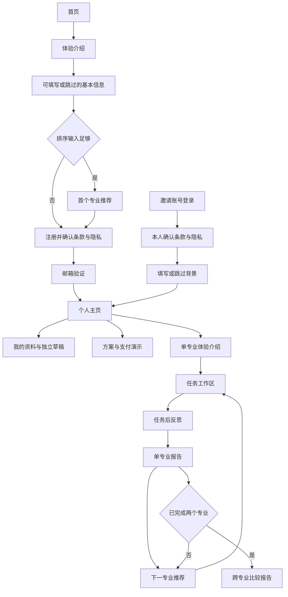

# MajorPilot MVP 信息架构与页面流程

> 状态：页面与应用边界确认稿 v0.3  
> 更新日期：2026-09-20  
> 适用范围：MajorPilot MVP 网站页面、导航与基础内部功能  
> 关联文档：[项目初始共识](./00-majorpilot-discussion-baseline.md) · [MVP 产品定义](./01-mvp-product-definition.md) · [技术约束与架构边界](./03-mvp-technical-constraints.md) · [RuoYi 基线选型](./05-ruoyi-baseline-selection.md) · [领域模型与数据边界](./06-domain-model-and-data-boundaries.md)

## 1. 文档目的

2026-11-14 补充：资料、主页卡片、支付演示和背景跳过以 [48](./48-profile-dashboard-and-payment-demo.md) 为当前要求。问卷是可选背景，不再要求先有推荐才能注册或开始体验；普通身份安全和 pilot 本人同意保持。下文早期顺序不限制这条跳过路径。

本文档把已经确认的产品流程落实为网站页面和系统入口。它用于指导后续线框图、数据模型和应用拆分，不规定最终视觉风格。前端技术及学生端、管理端的工程边界以技术文档为准。

## 2. 已确认的界面原则

- 首次信息收集控制在 3–5 分钟；
- 使用现有 12 页背景表单，单题与整份均可跳过，不把缺失信息补成默认答案；
- 排序输入足够时展示推荐专业和理由；没有推荐也可继续注册和自主选择专业；
- 普通模式注册采用邮箱和密码并验证邮箱；邀请模式使用预置账号，本人条款与隐私确认仍必需；
- 登录后进入个人主页；
- 桌面任务工作区采用左侧步骤、中间任务、右侧 AI 帮助的布局；
- 手机支持了解产品、填写信息和查看报告，不要求完成正式任务；
- 报告优先以账户内网页形式呈现，并支持浏览器打印；报告只能由本人登录查看；
- 内部分析初期提供结构化数据、基础概览和 CSV 导出，后期再加强；
- 学生端使用独立的 Vue 3 TypeScript 产品前端；
- 内部页面使用独立的 RuoYi Vue 3 TypeScript 管理端；
- 学生账户与内部管理员账户分离，两个登录入口和权限体系不得串用；
- 专业任务使用仓库中的版本化配置和内容文件管理，管理端只提供必要的版本状态和运行查询，MVP 不开发完整内容管理系统。

## 3. 页面地图

### 3.1 公共页面

- 首页
- 产品如何工作
- 三个专业的体验说明
- 数据使用与隐私说明
- 服务条款
- 登录
- 注册
- 找回密码

### 3.2 首次引导页面

- 体验介绍
- 基本信息多步骤表单
- 推荐生成状态
- 首个专业推荐结果
- 注册承接页

### 3.3 登录后页面

- 个人主页
- 我的资料与资料编辑（独立于账户设置）
- 方案与支付（演示，无订单或扣款）
- 单专业体验介绍
- 任务工作区
- 任务结束反思
- 单专业报告
- 专业差异说明
- 下一专业选择
- 跨专业比较报告
- 账户与数据设置

### 3.4 内部页面

- 管理员登录
- 运行概览
- 用户与体验记录查询
- 任务版本与完成情况
- 推荐结果与改选情况
- 错误和中断概览
- 数据导出

内部页面位于独立的 RuoYi 管理端，只服务于产品验证、内容版本确认和运行排查，不与学生端共用导航，也不在 MVP 阶段扩展为完整运营平台。

### 3.5 应用与账户边界

- `majorpilot-web` 承载公共页面、首次引导、学生账户和全部专业体验页面；
- `majorpilot-admin` 承载内部管理页面，不向学生开放；
- `mp_student_account` 保存注册学生账户，`sys_user` 保存内部系统操作者；
- 学生会话只能访问学生 API，管理会话只能按角色权限访问管理 API；
- 两类账户即使邮箱相同，也不因此获得另一端权限；
- 内部人员查看报告、敏感文本或导出数据必须具备专门权限并产生审计记录。

## 4. 核心页面流

## 5. 公共页面

### 5.1 首页

首页需要让用户快速理解：

- MajorPilot 解决的是专业选择问题；
- 用户会实际完成专业任务，而不是只做问卷；
- 首批支持 AI、Data Science 和 Business Analytics；
- 单个体验约需 45–60 分钟；
- 完成一个专业获得单专业报告，完成两个后获得比较报告；
- 产品不会输出录取概率或专业适配度总分。

首页主要行动按钮为“获取我的首个体验建议”。登录入口作为次要操作保留。

### 5.2 产品如何工作

用简短步骤解释完整过程：

1. 自愿填写基本信息，也可稍后补充；
2. 信息足够时获得首个推荐，或自主选择开放专业；
3. 完成真实任务；
4. 查看体验报告；
5. 比较第二个专业。

页面同时说明 AI 的职责、报告边界和数据使用原则。

### 5.3 专业体验说明

分别介绍三个专业的任务类型和核心差异，但不提前暴露完整任务答案。用户需要看到的是自己将体验什么，而不是传统专业宣传内容。

### 5.4 隐私与条款

在用户填写信息前提供易读摘要，并链接完整文本。至少说明：

- 收集哪些信息和行为记录；
- 为什么收集；
- 哪些数据用于生成个人报告；
- 哪些数据用于产品分析；
- 保存期限；
- 用户如何删除账户和相关数据；
- AI 服务提供方可能接触哪些经过控制的数据。

## 6. 首次信息收集

### 6.1 表单结构

信息收集采用多步骤表单，每页只处理一个主题，预计 3–5 分钟完成。建议分为四组：

1. **申请计划**：申请阶段、预计时间和目标地区；
2. **学习背景**：当前学习方向和知识基础；
3. **专业考虑**：正在比较的专业和已有认识；
4. **任务偏好与困惑**：感兴趣的任务类型、主要疑问和来源渠道。

当前定义为 12 页、13 个字段；每页只处理一个主题。完整性用于说明还有哪些资料未填写，不作为注册或开始体验的门槛。

### 6.2 表单交互

- 显示清楚的步骤和整体进度；
- 每一步自动保存在匿名临时会话中；
- 允许返回修改答案；
- 提供单题跳过和整份暂不填写，保留已经填写的部分；
- 在提交前说明哪些信息将用于推荐和分析；
- 对自由文本设置合理长度限制；
- 不要求用户在注册前提供姓名；
- 临时会话需要设置自动过期和清理机制。

## 7. 推荐结果页

排序信息足够时，推荐结果页在注册前展示：

- 推荐的首个专业；
- 2–4 条简短推荐依据；
- 推荐不代表适配结论的说明；
- 另外两个专业与推荐专业的主要差异；
- 用户可以在注册后接受推荐或自由改选的说明；
- 注册并开始体验的主要按钮。

页面不得只显示“结果已生成，请注册查看”。注册价值应表述为保存个性化结果、开始完整任务和积累跨专业比较，而不是解锁已经承诺的基础结果。

## 8. 注册与登录

### 8.1 注册

注册采用邮箱和密码。用户完成注册后，将匿名临时会话中的问卷和推荐结果绑定到独立的 `mp_student_account` 学生账户。注册流程不创建或修改 RuoYi 的 `sys_user` 管理账户。

最低功能包括：

- 邮箱格式检查；
- 密码强度提示；
- 重复邮箱处理；
- 邮箱验证；
- 用户同意条款和隐私政策的版本记录；
- 注册失败后的可恢复状态；
- 防止问卷和推荐结果在注册失败时丢失。

### 8.2 登录安全底线

- 密码只保存经过成熟算法处理的不可逆哈希；
- 不在日志、分析事件或错误报告中记录密码；
- 提供安全的密码重置流程；
- 登录、注册和重置接口需要速率限制；
- 学生登录态优先使用 HttpOnly、Secure、SameSite 合理配置的安全 Cookie，并启用适当的过期和撤销机制；
- 对跨站请求、自动化注册和撞库风险设置基础防护；
- 邮箱验证和密码重置令牌必须短期有效且只能使用一次。

第三方登录或免密码登录可以后续增加，但不是 MVP 前置条件。

## 9. 个人主页

个人主页是登录后的默认入口，主要包含：

- 用户当前的专业选择目标；
- 系统推荐的首个或下一个专业；
- AI、Data Science 和 Business Analytics 三个体验的状态；
- 继续上次任务；
- 已完成的单专业报告；
- 跨专业比较报告入口；
- 修改基础信息并重新生成建议的入口；
- 查看已提交资料、继续草稿和从空白重填的入口；资料不足时不显示个性化初始推荐，但可自行选择开放专业；
- 账户和数据设置入口。

体验状态至少区分：未开始、准备开始、进行中、等待反思、已暂停、已完成和已被恢复体验替换。报告准备状态独立显示。第三个专业保持可选，不使用强制完成感较强的进度设计。

## 10. 单专业体验介绍页

开始任务前展示：

- 本次扮演的专业角色；
- 任务背景；
- 预计时间；
- 最终需要完成的成果；
- 是否包含代码、数据或模型操作；
- 当前设备是否适合完成；
- 过程记录及其用途；
- “开始任务”按钮。

用户必须能够在开始前退出，不因打开介绍页而被记为正式开始。

个人主页允许保留多个准备开始／已暂停的专业，但同一时刻只有一个活动体验。选择其他专业时明确确认暂停原体验，原子切换成功后进入目标；回到旧专业继续同一运行和版本。反思也可暂停，未提交不算完成；详情见 `06`、`12`、`14`。

## 11. 任务工作区

### 11.1 桌面布局

任务工作区采用三栏结构：

- **左栏**：步骤导航、完成状态和预计剩余时间；
- **中栏**：任务说明、数据、图表、代码和回答区域；
- **右栏**：与当前步骤相关的 AI 帮助和分层提示。

中栏是视觉重点。左右栏应能折叠，避免代码、表格和图表区域过窄。

### 11.2 任务交互

- 用户可以在允许的步骤间返回；
- 每次关键修改自动保存；
- 执行中的任务显示明确状态；
- 执行失败时保留用户输入并给出可恢复提示；
- AI 只使用当前任务允许的上下文；
- 请求提示时先显示帮助层级，不立即给出完整步骤；
- 用户离开页面时不丢失最近保存的进度；
- 任务版本在开始后固定，避免进行中被内容更新影响。

### 11.3 手机行为

手机用户可以查看任务介绍和已有进度，但正式开始时提示使用电脑或平板。已经在电脑开始的任务不在手机上提供不完整的编辑体验。

## 12. 任务后反思

反思页面在任务完成后单独出现，避免与答案评价混在一起。问题围绕：

- 最感兴趣的环节；
- 最困难或最令人抗拒的环节；
- 用户是否愿意反复完成类似任务；
- 用户认为困难来自知识、工具、时间还是任务类型；
- 用户对该专业的看法发生了什么变化。

AI 可以根据任务过程提出有限追问，但需要允许用户跳过非必要追问。

## 13. 单专业报告

报告以账户内网页呈现，并提供浏览器打印友好样式。基础结构包括：

1. 本次体验概览；
2. 用户完成的任务成果；
3. 体验偏好；
4. 当前准备度；
5. 本次任务表现；
6. 专业特有观察；
7. 证据和结论边界；
8. 另外两个专业的差异；
9. 下一专业建议。

MVP 不提供公开或链接分享。报告只能由所属用户登录后查看。PDF 下载作为后续增强项，不阻塞 MVP。

## 14. 跨专业比较报告

用户完成两个专业后生成比较报告。页面并排呈现共同维度和专业特有体验，重点说明不同任务分别要求用户做什么、用户如何感受以及哪些问题仍需继续验证。

比较报告不提供总排名或唯一答案。用户完成第三个专业后，应在同一报告中扩展比较，而不是创建相互冲突的新报告。

## 15. 账户与数据设置

至少提供：

- 修改邮箱；
- 修改密码；
- 查看当前隐私和条款版本；
- 查看主要数据类别及用途；
- 撤销可选研究授权；
- 请求导出个人报告；
- 删除账户和相关数据；
- 退出登录。

账户删除需要说明立即删除和延迟清理的数据范围，不使用含糊的“停用账户”替代删除。

确认删除立即撤销所有登录并清理本机草稿；之后通过独立只读回执页查看进度，不留在需要登录的个人主页。回执凭证不是账号恢复凭证，详见 `12` §7.3。

## 16. 基础内部分析

### 16.1 初期概览

内部页面优先显示：

- 信息收集开始和完成数量；
- 推荐专业分布；
- 推荐接受与改选情况；
- 注册转化；
- 三个任务的开始、完成和中断情况；
- 各步骤退出位置；
- 提示请求层级与频率；
- 单专业报告和比较报告生成情况；
- 下一专业推荐接受情况；
- 用户反馈汇总。

### 16.2 查询与导出

- 按时间、专业、任务版本和用户状态筛选；
- 导出经过权限控制的 CSV；
- 默认使用假名化用户标识；
- 敏感自由文本不默认进入通用导出；
- 每次导出记录操作者、时间、条件和用途；
- 后续可根据实际分析需求扩展漏斗、分群、留存和任务质量分析。

初期内部页面的目标是支持验证和排错，不追求完整商业智能平台。

内部页面沿用 RuoYi 的角色和菜单权限能力。学生身份不能登录管理端；查看用户报告、读取敏感自由文本和导出数据分别设置权限点，不以“能够登录后台”代替细粒度授权。

## 17. 任务内容文件

任务内容存放在代码仓库的版本化配置和内容文件中。建议将以下内容与应用逻辑分离：

- 任务元数据；
- 步骤结构；
- 中英文内容；
- 数据和静态资源引用；
- 输入组件配置；
- 评价规则；
- 分层提示；
- 反思问题；
- 报告字段映射；
- 内容和审核版本。

应用启动或构建时需要验证内容文件，防止缺少步骤、无效引用、重复标识或未配置提示等问题进入运行环境。

## 18. 页面级基础验收

1. 用户能够在 3–5 分钟内完成首次信息收集；
2. 推荐页在注册前显示真实结果和简短依据；
3. 注册失败或邮箱验证中断不会丢失问卷与推荐结果；
4. 登录后个人主页准确反映三个专业的状态；
5. 桌面任务工作区在常见屏幕宽度下能够同时使用步骤、任务和 AI 帮助；
6. 手机页面不会诱导用户进入无法正常完成的任务；
7. 任务刷新、返回或短暂断网后能够恢复最近状态；
8. 用户完成一个专业后能查看网页报告；
9. 用户完成两个专业后能查看比较报告；
10. 内部概览和 CSV 数据能够追溯到正确的任务、推荐和内容版本；
11. 用户能够找到并完成密码重置、退出登录和账户删除；
12. 所有数据收集入口与隐私说明保持一致。

## 19. 设计交付与下一入口

页面线框与关键状态见 `14`；`mp_student_account`、推荐、任务、事件和报告的数据模型见 `11`；双前端、受限执行、AI 调用和版本化内容的工程验证方案见 `15`。实施里程碑和需求追溯见 `16`。

下一入口是 P0 技术基线验证，而不是继续扩大页面范围。P0 需要实测 RuoYi、双前端、身份隔离、受限执行、Bailian 和本地基础设施。管理端能够启动仍不等于学生端体验闭环已经完成。
