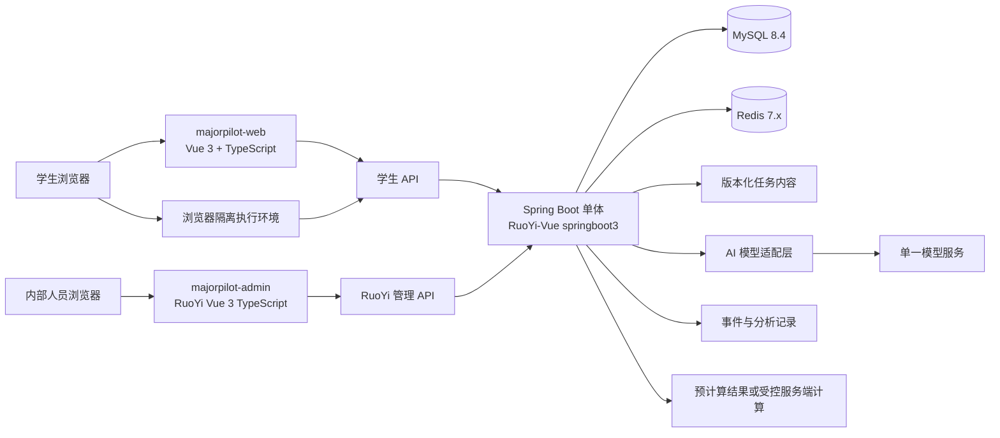

# MajorPilot MVP 技术约束与架构边界

> 状态：技术基线确认稿 v0.2  
> 更新日期：2026-09-20  
> 适用范围：MajorPilot MVP 技术验证与本地运行  
> 关联文档：[MVP 产品定义](./01-mvp-product-definition.md) · [信息架构与页面流程](./02-mvp-information-architecture.md) · [模型服务评估](./04-model-provider-evaluation.md) · [RuoYi 基线选型](./05-ruoyi-baseline-selection.md) · [领域模型与数据边界](./06-domain-model-and-data-boundaries.md)

## 1. 已确认的技术约束

- 初期规模按 100–500 个账户设计；
- 同时在线用户按不超过约 20 人设计；
- MVP 先在本地运行，不立即公开部署；
- 系统结构需要保留未来部署到远程环境的可迁移性；
- 初期只使用一个 AI 模型服务；
- 模型调用通过统一适配层接入，避免业务逻辑直接依赖供应商接口；
- 轻量代码优先在浏览器隔离环境中执行；
- 较重的模型结果使用服务端调用或预计算数据；
- 用户报告只能由本人登录后查看；
- MVP 不提供公开、永久或令牌式报告分享；
- 首个开发与运行环境为当前 macOS 机器；
- 后端基于官方 RuoYi-Vue 3.9.2 `springboot3` 分支，当前基准为 Spring Boot 3.5.16；
- 开发与运行使用 JDK 21，初期保留上游 Java 17 编译级别；
- 后端保持单体，不采用 RuoYi-Cloud 或提前拆分微服务；
- 学生端采用独立 Vue 3 + TypeScript + Vite 应用；
- 内部管理端采用官方 RuoYi Vue 3 TypeScript 应用；
- 数据库采用 MySQL 8.4 LTS，缓存与会话基础设施采用 Redis 7.x；
- 初期沿用上游 MyBatis + XML + PageHelper，不混入 MyBatis-Plus；
- 两个前端与后端保持独立工程和清晰 API 边界；
- RuoYi 的 `sys_user` 只用于内部操作者，学生使用独立的 `mp_student_account` 账户域；
- MVP 初期直接在当前项目目录中运行，暂不以容器作为开发前置条件；
- 注册邮件在本地使用邮件测试接收器；
- Chrome 为首要支持浏览器，Edge 作为同内核兼容目标，Safari 后续补齐；
- MVP 首个模型服务接入阿里云百炼；DeepSeek 用于离线对照，OpenAI 仅在有必要时加入评测；
- API Key 保存在本地环境文件中，不使用 Apple 钥匙串；
- 环境文件不进入版本控制，真实密钥只允许 Spring Boot 后端读取。

## 2. 本地运行不等于一次性原型

本地运行用于降低首个技术验证版本的部署和运维成本，不代表系统可以依赖单台开发机器上的临时状态。架构仍应满足：

- 环境可以通过明确命令重复启动；
- 数据库结构和种子数据可以重建；
- 任务内容与应用版本可追溯；
- 密钥和密码不写入仓库；
- 本地文件路径不进入业务数据；
- AI、邮件和其他外部服务均通过可替换接口接入；
- 未来迁移到远程环境时不需要重写核心业务逻辑。

## 3. 概念架构



该图定义职责边界。系统采用两个前端、一个后端单体：学生端承载产品体验，RuoYi 管理端承载内部权限和运行管理。后端版本、Java、MySQL、Redis 和持久层基线已经确认；百炼为首个接入供应商，具体模型和区域仍需通过账号能力与评测确定。

## 4. 浏览器内轻量执行

浏览器执行环境用于完成受控的数据和代码任务。它需要满足：

- 只能加载任务声明允许的代码和数据；
- 不允许访问用户本地文件，除非未来设计明确的受控上传功能；
- 不允许任意访问外部网络；
- 设置单次执行时间和内存上限；
- 执行失败不会破坏用户已保存的任务进度；
- 保存用户修改内容、执行状态和必要的结构化结果；
- 对不同浏览器提供一致的任务结果；
- 不把模型密钥或其他服务端秘密发送到浏览器。

首批任务需要优先使用适合浏览器完成的轻量数据规模。耗时训练、大模型推理或依赖复杂系统环境的步骤应改用预计算结果、受控 API 或服务端任务。

## 5. AI 模型适配层

业务功能只能调用内部统一接口，不直接依赖模型供应商的请求格式。适配层至少负责：

- 请求与响应格式转换；
- 模型和提示词版本记录；
- 超时、重试和错误分类；
- 输入长度和输出长度限制；
- 结构化输出校验；
- 敏感字段过滤；
- 成本和调用量记录；
- 测试环境中的模拟响应；
- 未来更换或增加供应商时的兼容边界。

MVP 不需要从第一天接入多个供应商，也不实现自动模型路由。统一接口的目的首先是隔离依赖和便于测试。

## 6. 身份与报告访问

学生使用邮箱和密码注册到独立的 `mp_student_account` 账户域；RuoYi 的 `sys_user` 只保存内部管理员和运营人员。两类账户使用不同登录入口、主体类型、Redis key 前缀和服务端权限校验，不能仅凭相同邮箱建立权限关系。

报告访问规则为：

- 所有报告默认私有；
- 只有报告所属账户登录后可以查看；
- 不生成公开分享链接；
- 不通过可猜测的编号暴露报告；
- 服务端在每次读取报告时验证资源归属；
- 浏览器打印不改变报告的访问控制；
- 内部人员访问用户报告需要独立权限和审计记录。

学生 API 使用 `/app/**` 或等价的独立命名空间，管理 API 保持 RuoYi 管理命名空间。任一学生令牌都不能调用管理接口，管理端登录态也不得直接充当学生身份。

本地开发环境需要提供可验证的学生注册、邮箱确认和密码重置流程。可以使用本地邮件接收工具或测试邮箱适配器，但不能在正式逻辑中绕过身份校验。后台创建 `sys_user` 的流程不得复用于公开注册。

## 7. 本地密钥管理

MVP 的模型 API Key 和其他服务端秘密保存在项目本地环境文件中，不使用 Apple 钥匙串。具体实现必须满足：

- 真实环境文件加入忽略规则，不进入版本控制；
- 仓库只提供不含真实值的环境变量示例文件；
- Vue 前端构建变量中不得出现模型 API Key；
- 只有 Spring Boot 后端在启动时读取密钥；
- 浏览器网络响应、前端源码、错误页面和分析事件中不得出现密钥；
- 启动时检查必需变量是否存在，但错误提示只显示变量名称，不显示变量值；
- 启动脚本不得使用会回显密钥的调试选项；
- 日志和异常对象需要对授权头、密钥字段和供应商原始请求进行脱敏；
- 环境文件使用仅当前用户可读写的文件权限；
- 密钥更换后不需要修改或重新构建前端；
- 如果环境文件曾被误提交或输出到日志，必须立即轮换密钥，不能只删除文件或提交记录。

建议的环境变量命名保持供应商边界清楚，例如：

```dotenv
MAJORPILOT_AI_PROVIDER=bailian
BAILIAN_API_KEY=
BAILIAN_BASE_URL=
BAILIAN_MODEL=
```

示例文件只保留变量名称和非敏感默认值。工程设计将真实文件统一为 `.env.local`，由本地启动脚本检查权限并加载给 Spring Boot；脚手架阶段验证该机制稳定工作。

## 8. 数据与分析边界

MySQL 承担账户、问卷、推荐、任务状态、结构化事件、反思和报告的持久化。RuoYi 原有系统表保持 `sys_` 等上游命名，MajorPilot 业务表统一使用 `mp_` 前缀。Redis 只保存适合缓存或短期会话的数据，不作为学生进度、报告或关键业务记录的唯一数据源。任务原始数据和内容文件不应与用户事务数据混放为不可追溯的临时文件。

初期内部分析包含：

- 基础运行概览；
- 按专业和任务版本筛选；
- 推荐接受与改选情况；
- 任务开始、完成、中断和退出位置；
- 提示请求和执行错误；
- 单专业及比较报告生成状态；
- 经过权限控制的 CSV 导出。

分析能力后续可以加强，但事件命名、任务版本、推荐版本和时间字段需要从 MVP 开始保持稳定，否则后期数据无法可靠比较。

## 9. 本地运行的基本组件

MVP 本地环境预计包含以下组件：

- `majorpilot-web` 学生端 Vue 3 TypeScript 应用；
- `majorpilot-admin` RuoYi Vue 3 TypeScript 管理端；
- 基于 RuoYi-Vue `springboot3` 的 Spring Boot 单体；
- MySQL 8.4 数据库；
- Redis 7.x；
- 本地邮件测试组件；
- 任务内容和种子数据加载器；
- AI 模型适配器；
- 浏览器轻量执行资源；
- 基础内部分析页面；
- 日志和错误记录。

两个前端和后端作为独立工程保存在当前项目目录中，通过明确的 HTTP API 通信。后端新增独立的 MajorPilot 业务模块，避免把产品逻辑散落到 `ruoyi-system`、`ruoyi-framework` 等通用模块中。业务表使用 `mp_` 前缀，学生接口和管理接口保持清晰边界。

MVP 初期分别使用本地启动命令运行两个前端、后端、MySQL、Redis 和邮件测试组件。所有启动步骤需要写入项目脚本或文档，避免依赖未记录的手工配置。容器化和一键编排作为后续部署准备工作，不阻塞首个版本。

## 10. 本地验收边界

技术验证至少需要证明：

1. 新环境可以根据文档完成安装和启动；
2. 用户注册、登录、邮箱验证和密码重置流程可以在本地完整演示；
3. 关闭并重新启动服务后，账户、任务进度和报告仍然存在；
4. 浏览器轻量执行在目标浏览器中得到一致结果；
5. 执行环境无法读取本地文件、外部网络或服务端密钥；
6. 模型服务不可用时，任务进度不会丢失，并显示可恢复错误；
7. 报告不能被其他普通账户读取；
8. 任务内容、推荐规则、提示词和报告均能追溯版本；
9. 内部概览与 CSV 导出的数字能够和数据库记录核对；
10. 日志不包含密码、会话令牌、模型密钥或不必要的完整用户内容；
11. 两个前端的构建产物和浏览器请求中都不存在模型 API Key；
12. 被忽略的本地环境文件能够向 Spring Boot 提供密钥，示例文件不包含真实值；
13. 学生令牌不能访问管理接口，管理端权限不会因为学生邮箱相同而授予；
14. Redis 被清空或重启时，不会丢失 MySQL 中的账户、任务进度和报告；
15. RuoYi 默认账户、默认 JWT secret、演示接口和不需要的管理入口已清除或关闭；
16. JDK 21、MySQL 8.4、Redis 7.x、管理端和学生端能够在目标 macOS 环境中共同运行。

## 11. 已完成的工程决策与验证项

Node 24 LTS、npm 11、Maven Wrapper、Flyway、目录、模块、会话安全、启动职责和测试层次已经在 `12` 与 `15` 中明确。学生端页面状态见 `14`；组件库只需在 P0 证明可访问性和视觉适配，不改变产品合同。

仍需在真实实施环境验证：

- 百炼账号所在区域、可用模型、API 端点、配额和数据条款；
- 浏览器执行引擎的确切版本和性能；
- 本地数据库备份、恢复和清理命令；
- 固定 RuoYi commit 与全部本地组件的兼容性；
- 未来公开部署的运行环境、域名、TLS 和运维方案。

前四项进入 `16` 的 P0/P8 门禁；公开部署不属于当前 MVP 设计阶段。
