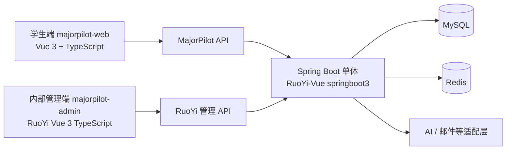

# MajorPilot 的 RuoYi 技术基线

> 状态：选型已确认 v0.2，尚未完成脚手架验证  
> 更新日期：2026-09-20  
> 信息时点：2026-09-20，实际建仓时还需再次核对上游提交  
> 关联文档：[MVP 产品定义](./01-mvp-product-definition.md) · [技术约束与架构边界](./03-mvp-technical-constraints.md)

## 1. 确认结论

MajorPilot MVP 已确认采用：

**官方 RuoYi-Vue 3.9.2 的 `springboot3` 分支作为后端与内部管理后台底座，学生端另建 Vue 3 + TypeScript 产品前端。**

当前基线不采用官方默认 `master` 的 Spring Boot 4 版本，也不采用 RuoYi-Cloud、RuoYi-Vue-Plus 6.X 或 RuoYi-Vue-Pro 完整版。

已确认的首个版本组合如下：

| 层级 | 建议 | 说明 |
| --- | --- | --- |
| 后端底座 | RuoYi-Vue 3.9.2 `springboot3` | 官方单体前后端分离版本 |
| 上游基准 | `a51a838b71b446ea27256900efe7ed2faa2a02fd` | 2026-09-20 核对到的 `springboot3` 分支提交；建仓时再复核并固定 |
| Spring Boot | 3.5.16 | 当前分支 `pom.xml` 的实际版本 |
| Java | JDK 21 运行与开发，暂保留上游 Java 17 编译级别 | 使用 LTS JDK，同时减少对上游源码的无必要改动 |
| 持久层 | 先沿用 MyBatis + XML + PageHelper | 不在搭底座时混入 MyBatis-Plus，避免扩大框架改造面 |
| 数据库 | MySQL 8.4 LTS | 以全新库运行；导入上游基础表后，再用版本化迁移维护 `mp_` 业务表 |
| 缓存与会话 | Redis 7.x | RuoYi 的登录、在线用户和缓存能力依赖 Redis；它是框架依赖，不是为扩容而引入 |
| 内部管理端 | 官方 RuoYi Vue 3 TypeScript 前端 | Vue 3、TypeScript、Vite、Element Plus、Pinia |
| 学生端 | 独立 Vue 3 + TypeScript + Vite 应用 | 采用面向学生任务流程的产品界面，不套用后台管理布局 |
| 构建方式 | Maven Wrapper 3.9.16；Node 24 LTS + npm 11.19.1 | 提交 `package-lock.json`，不依赖开发机全局漂移版本 |

这里的版本组合已经成为规划与脚手架基线，但不代表代码已经下载、初始化或通过本地运行验证。

## 2. 为什么推荐官方 RuoYi-Vue `springboot3`

### 2.1 与 MVP 所需能力吻合

MajorPilot 需要的通用底座主要是：

- 内部管理员登录、角色和权限；
- 菜单、字典、参数配置；
- 操作日志和登录日志；
- 基础代码生成；
- MySQL、Redis、JWT 和 Spring Security 集成；
- 单体后端与明确的 HTTP API。

这些能力官方 RuoYi-Vue 已经具备。MajorPilot 真正需要投入设计的部分是信息收集、专业推荐、三类体验任务、过程事件、AI 提示、反思和报告，而不是多租户、工作流、支付、商城、微服务治理或分布式任务平台。

### 2.2 Spring Boot 3 比当前 Boot 4 主分支更适合作为 MVP 基线

官方仓库当前同时维护 Spring Boot 2、3、4 三条分支，默认 `master` 已进入 Spring Boot 4。选择 `springboot3` 的原因不是追求旧版本，而是：

- Spring Boot 3.5 仍是现代 Jakarta 技术栈；
- JDK 21 可以直接承担开发和运行；
- 第三方库、示例和问题排查资料通常比刚切换的大版本更稳定；
- MajorPilot 的竞争力不来自使用最新框架大版本，不值得在 MVP 阶段承担无关迁移风险。

不选择 Java 8、Spring Boot 2 和 Vue 2 的旧组合。它们适合维护已有系统，不适合作为这个全新产品的起点。

### 2.3 体量相对可控

RuoYi-Vue-Plus 和 RuoYi-Vue-Pro 都提供了比官方版更丰富的工程能力，但也带来更多框架约定、模块和基础设施。对近期只有 100–500 个账户、并发不超过约 20 人的本地 MVP，这些能力不会形成用户价值，反而会增加理解、裁剪、升级和排错成本。

## 3. 不把若依后台当成学生网站

建议将系统划分为两个前端、一个后端单体：

两个前端的职责不同：

- `majorpilot-web`：面向学生，承载信息收集、专业推荐、任务工作区、提示、反思和报告；
- `majorpilot-admin`：面向内部人员，承载任务内容配置、版本管理、用户支持、运行状态和聚合分析；
- 后端保持一个可部署单体，不提前拆微服务。

这样仍然是“基于 RuoYi 开发”，但不会让学生产品受限于管理后台的菜单、表格和工作台设计。

## 4. 管理员账户与学生账户必须分域

官方 RuoYi 的 `sys_user` 表描述的是系统操作者。MajorPilot 不应把公开注册的学生直接塞进 `sys_user`。

建议：

- `sys_user` 只保存内部管理员和运营人员；
- 使用独立的 `mp_student_account`、会话、验证令牌和 Decision Profile 等业务表；
- 学生接口使用 `/app/**` 或 `/api/app/**`，管理接口保持独立命名空间；
- 学生令牌与管理员令牌使用不同的登录入口、主体类型、Redis key 前缀和权限校验；
- 任一学生令牌都不能调用管理端接口；
- 管理员查看用户报告需要专门权限并写入审计记录；
- 邮箱验证、密码重置和注册流程属于 MajorPilot 业务模块，不复用后台创建系统用户的流程。

这是本方案中比具体 UI 库更重要的安全边界。

## 5. 后端扩展方式

新增明确的 MajorPilot 业务模块 `ruoyi-majorpilot`，将产品业务与若依原有系统模块分开。业务表统一使用 `mp_` 前缀。

模块边界为：

- `identity`：学生注册、邮箱验证、登录和密码重置；
- `onboarding`：基础信息收集；
- `recommendation`：首个专业推荐和版本化规则；
- `experience`：AI、DS、BA 三类任务与进度；
- `workspace`：浏览器轻量执行状态和结果；
- `guidance`：分层提示与模型适配；
- `reflection`：任务后反思；
- `report`：单专业报告与跨专业比较；
- `analytics`：只供后台分析的结构化事件和聚合查询。

上游模块的处理原则：

- 保留 `ruoyi-common`、`ruoyi-framework`、`ruoyi-system`、`ruoyi-admin`；
- `ruoyi-generator` 只作为开发工具，不对普通生产管理员开放；
- `ruoyi-quartz` 暂不承担核心任务流程，没有明确用途时关闭相关入口；
- 删除演示接口、默认账户和无关菜单；
- 不直接修改通用模块来塞入产品逻辑，减少以后吸收上游安全修复的冲突。

## 6. Redis 是这次选择带来的新增约束

此前技术约束只明确了 Vue、Spring Boot 和 MySQL。采用 RuoYi 后，Redis 已确认加入本地基础组件，因为官方实现明确将其用于令牌、在线用户和缓存。

不建议为了保持“只有 MySQL”而先重写若依的认证与缓存层。对 MVP 来说，运行一个本地 Redis 比维护一套偏离上游的认证实现风险更低。

如果后续提出移除 Redis，应重新评估是否还值得采用 RuoYi，而不是在没有替代设计和验证的情况下拆除其基础机制。

## 7. 各候选版本的判断

| 候选 | 优点 | 对 MajorPilot 的问题 | 结论 |
| --- | --- | --- | --- |
| 官方 RuoYi-Vue 3.9.2 `springboot3` | 官方、单体、功能边界较小、Spring Security、资料多 | MyBatis XML 较传统；仍依赖 Redis | **首选** |
| 官方 RuoYi-Vue 3.9.2 `master` | Spring Boot 4，代码最新 | 新大版本生态风险对 MVP 没有直接收益 | 暂不选 |
| RuoYi-Vue-Plus 6.X | Vue 3 TS、MyBatis-Plus、Sa-Token、扩展能力强 | 官方定位包含分布式集群升级；模块和基础设施明显超过 MVP 需要 | 暂不选 |
| RuoYi-Vue-Pro 精简版 `master-jdk17` | Spring Boot 3.5、MyBatis-Plus、文档和代码生成能力丰富 | 即使精简版也更重，框架约定和 Redis/Redisson 能力更多 | 第二选择 |
| RuoYi-Vue-Pro 完整版 | 业务模块极多 | 工作流、支付、商城、CRM、AI 等大量无关模块增加负担 | 不选 |
| RuoYi-Cloud | 微服务、Nacos、网关和分布式治理 | 与本地小并发单体 MVP 的规模完全不匹配 | 不选 |
| Java 8 / Boot 2 / Vue 2 老版本 | 遗留项目兼容性好 | 新项目技术债和后续升级成本高 | 不选 |

如果后续负责开发的人明确要求 MyBatis-Plus，并且愿意接受更重的工程结构，再把第二选择切换为 **RuoYi-Vue-Pro 精简版 `master-jdk17`**。目前没有足够收益支持这次切换。

## 8. 上游代码管理策略

不要长期直接跟随一个会移动的分支头。正式初始化时应：

1. 再次读取 `springboot3` 的 `pom.xml`、安全公告和最近提交；
2. 固定一个明确 commit，并记录来源、分支、许可证和导入日期；
3. 以 MajorPilot 自己的仓库为主仓库，不把上游仓库当部署源；
4. 记录对若依通用层的所有修改；
5. 只主动吸收安全修复和确认有价值的 bug fix，不自动追最新分支；
6. 大版本升级单独评估，不与产品功能开发混在一次变更中。

## 9. 脚手架阶段必须验证的风险

在正式投入业务开发前，先完成一个很小的技术基线验证：

1. JDK 21 能完整编译并运行当前 Spring Boot 3 分支；
2. MySQL 8.4 和选定 Redis 版本能够导入并运行原始功能；
3. 官方 Vue 3 TypeScript 管理端能够登录、加载权限菜单和退出；
4. 学生端能够通过独立接口注册和登录，且不能访问任何管理接口；
5. 重启后会话、账户和业务数据行为符合预期；
6. 默认账户、默认 JWT secret、演示接口和不安全样例已清除；
7. 环境文件被忽略，百炼 API Key 只由后端读取；
8. 一个 `mp_` 示例表可以通过版本化迁移创建，并完成最小 CRUD 测试；
9. 上游管理端与自建学生端可以同时对接同一个后端，而不存在跨域和令牌串用问题。

这些检查通过后，才把当前“决策基线”升级为“已验证实施基线”。如果验证发现明确兼容性问题，应记录证据后重新讨论，而不是静默更换版本。

## 10. 已确认的配套变化

本次选型同时确认以下三项配套变化：

1. 本地组件由 MySQL 扩展为 **MySQL + Redis**；
2. 前端不是一个项目，而是 **学生端产品前端 + 若依内部管理端**；
3. 后端持久层初期沿用 **MyBatis XML**，不为了语法便利立即改造为 MyBatis-Plus。

## 11. 调研来源

- [官方 RuoYi-Vue 仓库](https://github.com/yangzongzhuan/RuoYi-Vue)
- [官方 RuoYi-Vue 3.9.2 发布页](https://github.com/yangzongzhuan/RuoYi-Vue/releases/tag/v3.9.2)
- [RuoYi-Vue-Plus 仓库](https://github.com/dromara/RuoYi-Vue-Plus)
- [RuoYi-Vue-Plus 6.0.0 发布页](https://github.com/dromara/RuoYi-Vue-Plus/releases/tag/v6.0.0)
- [RuoYi-Vue-Pro 仓库及版本说明](https://github.com/YunaiV/ruoyi-vue-pro)
- [官方 RuoYi-Cloud 仓库](https://github.com/yangzongzhuan/RuoYi-Cloud)
