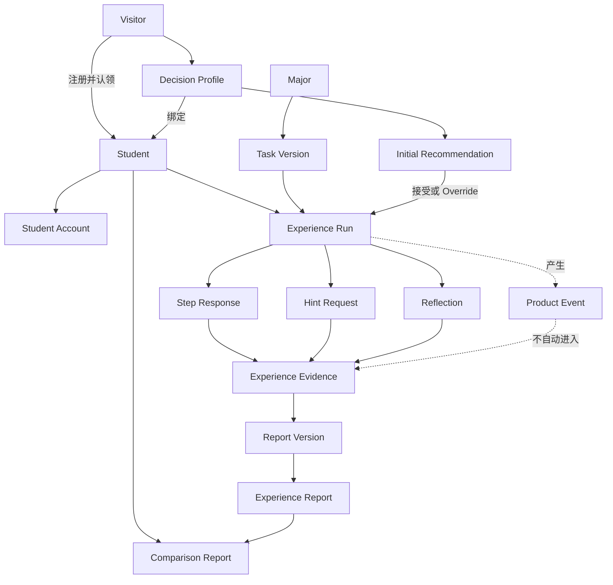
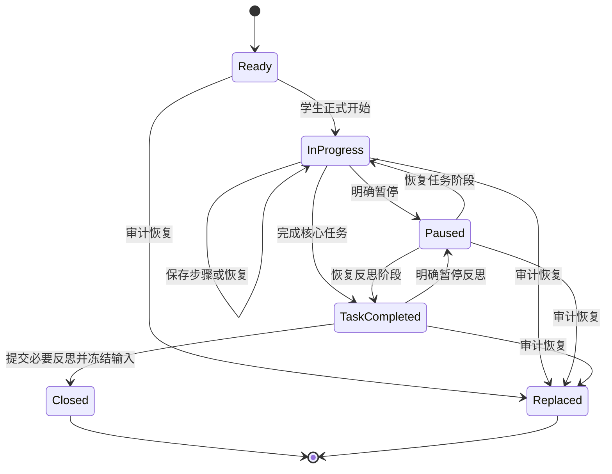
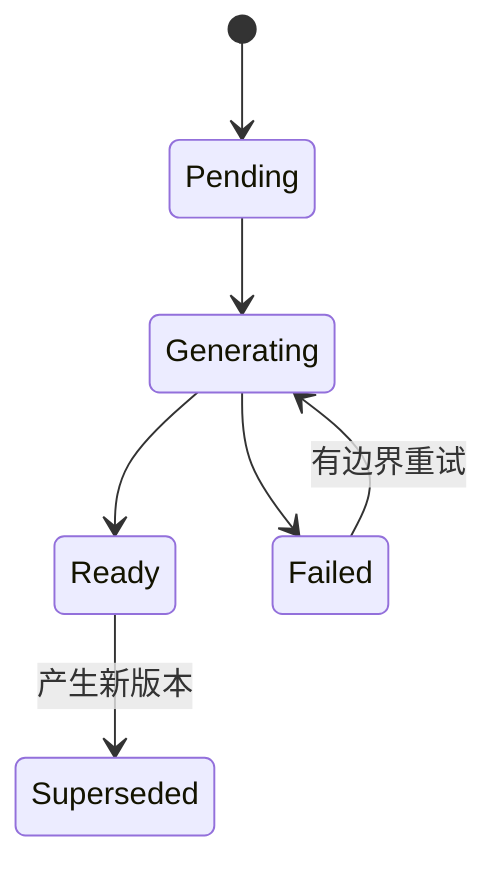

# MajorPilot MVP 领域模型与数据边界

> 状态：领域边界修订稿 v0.3  
> 更新日期：2026-09-20  
> 适用范围：MVP 数据模型、模块职责、状态设计和后续接口设计  
> 关联文档：[领域语言](../CONTEXT.md) · [MVP 产品定义](./01-mvp-product-definition.md) · [信息架构](./02-mvp-information-architecture.md) · [技术约束](./03-mvp-technical-constraints.md) · [RuoYi 技术基线](./05-ruoyi-baseline-selection.md)

## 1. 文档目的

本文档将已确认的产品流程转换为领域对象、生命周期和数据责任边界。它先回答“系统需要记住什么、由谁拥有、何时可以变化”，暂不规定数据库字段、Java 类名或接口路径。

本文档定义领域语义和责任边界；对应逻辑表、字段、约束和留存规则已经在 `11` 中落实。后续实现可以调整类和包的机械结构，但不能静默改变这里的主体、生命周期和证据含义。

## 2. 建模原则

- 不使用笼统的“用户”表示所有身份，明确区分访客、学生和内部操作人员；
- 学生账户与内部操作人员账户属于不同身份域；
- 规则推荐、AI 解释和学生最终选择分别保存，不能互相覆盖；
- 任务内容按版本发布，一次体验开始后固定其任务版本；
- 产品分析事件不自动成为报告证据；
- 报告只能引用可追溯的体验证据和学生反思；
- 关键生成结果保留版本，不用覆盖更新破坏历史解释；
- Redis 只保存缓存和短期状态，领域事实以持久化记录为准；
- 领域模块是单体内部边界，不代表拆分微服务。

## 3. 领域模块

| 领域模块 | 主要责任 | 拥有的核心概念 | 不负责 |
| --- | --- | --- | --- |
| 身份与访问 | 学生身份、内部身份、登录恢复和权限边界 | Student、Student Account、Internal Operator、Operator Account | 推荐规则、任务内容、报告生成 |
| 初始信息 | 匿名信息收集、版本化背景快照、注册后认领 | Visitor、Decision Profile | 判断最适合的专业 |
| 专业与内容 | 三个专业及经过审核的任务版本 | Major、Task Version | 保存学生作答和报告 |
| 推荐 | 产生首个和后续体验建议，保存依据与改选 | Initial Recommendation、Next Recommendation、Override | 替学生作最终决定 |
| 专业体验 | 创建并推进一次任务体验，保存步骤输入和进度 | Major Experience、Experience Run、Step Response | 自由聊天、动态生成整项任务 |
| 引导与反思 | 分层提示和任务后反思 | Hint Request、Reflection | 修改基础推荐结果 |
| 证据与报告 | 选择合格证据并生成可追溯报告版本 | Experience Evidence、Experience Report、Comparison Report、Report Version | 把分析事件直接解释为能力 |
| 产品分析 | 记录产品运行事件、形成聚合和受控导出 | Product Event | 生成面向学生的结论 |

## 4. 核心关系

这张图表达概念关系，不是数据库外键图。特别需要保留两条边界：

1. Product Event 可以帮助分析页面和漏斗，但不能未经解释就写入报告；
2. Internal Operator 不属于学生体验链路，只能通过经过授权和审计的内部入口查看必要数据。

## 5. 身份与匿名信息认领

### 5.1 匿名阶段

访客可以在注册前完成信息收集并获得首个推荐。匿名阶段至少需要保存：

- 匿名流程标识；
- 问卷版本和逐步保存状态；
- Decision Profile 快照；
- 推荐规则和解释版本；
- 推荐结果和生成时间；
- 过期时间。

匿名记录不能依赖浏览器中可修改的数据作为唯一事实来源，也不能包含长期有效的访问凭证。

### 5.2 注册认领

注册成功后，匿名 Decision Profile 和 Initial Recommendation 只能被一个 Student Account 认领一次。认领操作需要满足：

- 注册失败或邮箱验证中断时不丢失匿名内容；
- 已认领记录不能被第二个账户再次认领；
- 认领过程重复提交时结果保持一致；
- 过期匿名记录按照数据说明清理；
- Operator Account 不能认领学生记录。

### 5.3 两类账户

Student Account 和 Operator Account 即使使用相同邮箱，也仍是不同身份。任何授权判断都依据当前身份域和权限，不依据邮箱是否相同。

## 6. Decision Profile 与推荐

Decision Profile 是一次完整提交形成的版本化快照，而不是会被持续覆盖的唯一“个人资料”。学生修改基础信息并重新生成建议时，应创建新的 Decision Profile 版本。

每次推荐需要保存：

- 使用的 Decision Profile 版本；
- 问卷版本；
- 推荐规则版本；
- 主推荐 Major；
- 可解释的规则依据；
- AI 解释使用的提示词、模型和参数版本；
- 学生最终接受或 Override 的结果；
- 生成时间和决定时间。

系统可以保留内部规则信号，但不得把它包装为专业适配度总分。AI 只解释规则产出的推荐，不能修改主推荐 Major。

## 7. Task Version 与发布

一个 Major 可以拥有多个 Task Version，但同一时刻只有经过审核并处于可用状态的版本可以分配给新体验。

Task Version 至少包含以下不可分割的版本边界：

- 情境和学习目标；
- 步骤结构及依赖；
- 数据、图表、文本样本和静态资源；
- 输入控件与允许的运行操作；
- 评价规则；
- 分层提示；
- 反思问题；
- 报告允许使用的证据字段；
- 内容审核记录。

Experience Run 开始后固定 Task Version。发布新版本不会改变进行中的体验，也不会让旧报告失去可解释性。

## 8. Experience Run 生命周期

MVP 生命周期为：

状态含义：

- `Ready`：学生已经选择专业，但尚未正式开始、不占用活动名额；
- `InProgress`：任务版本已经固定，允许保存和恢复；
- `TaskCompleted`：核心任务完成，但反思尚未完成；
- `Paused`：明确暂停并释放活动名额，保留暂停前阶段、Task Version 和全部已保存进度；
- `Closed`：必要反思已提交，报告输入引用已冻结；证据快照和报告可以仍在异步准备中；
- `Replaced`：异常恢复时被新运行替换的未完成记录，不算体验完成，不生成完成报告。

只有明确点击“暂停”或确认切换专业才进入 Paused；关闭网页、退出登录或长时间无活动不自动改变领域状态。流失是分析结论，不是完成或不可逆放弃。恢复 Paused 时回到其原阶段，不重新计为开始、不清空输入、不改变 Task Version。

同一学生同一时刻最多一个活动体验（InProgress 或 TaskCompleted），可以保留多个 Ready／Paused 体验。每个 Major 最多一个未被替换的运行，Closed 也占用该专业唯一位置，因此学生不能自行重做。首次开始时固定 Task Version、Decision Profile 和推荐决定；Ready 改选不绑定到另一专业，复用／创建目标专业的 Ready Run。

切换专业须原子地暂停当前活动体验并开始／恢复目标体验；失败时两者都保持原状。旧标签页不得继续写入已暂停运行。已关闭运行不可恢复或替换；报告错误走重生成。未完成运行因异常需重新创建时，操作人员在同一事务将旧运行置为 Replaced、创建有来源和原因的新 Ready Run并审计；旧答案、反思、版本及执行记录不改写，不把旧运行标成完成。

关闭事务固定 `decision_profile_id`、任务版本、最终步骤 revision、执行记录和 Reflection 引用及校验值，创建持久化证据作业；不在事务内调用 AI。成功快照不可变，失败构建可增加新版本，详细约束见 `11`。

## 9. 保存进度与步骤输入

Step Response 需要同时支持选择、短文本、排序、参数、局部代码和结构化运行结果。保存原则为：

- 每条输入绑定 Experience Run、步骤和 Task Version；
- 自动保存具有顺序或版本信息，迟到请求不能覆盖更新内容；
- 执行失败不会清空最近一次成功保存的输入；
- 原始输入、标准化结果和评价结果分开；
- 浏览器执行结果只保存任务允许的结构化内容；
- 重新进入任务时能够恢复到最近有效步骤。

## 10. 提示、反思与证据

### 10.1 Hint Request

每次 Hint Request 绑定具体步骤、请求层级和当时允许使用的上下文。需要保留请求时间、响应版本、是否成功以及是否使用了降级或重试。

提示次数本身不是能力证据。它可以作为体验过程的一部分，但报告中的解释必须结合任务情境和学生反思，不能直接把“多次求助”解释为能力不足。

### 10.2 Reflection

Reflection 保存学生本人对兴趣、困难、意外、挫败和继续意愿的陈述。AI 追问与学生回答需要区分保存，跳过可选追问不应被解释为负面信号。

### 10.3 Experience Evidence

Experience Evidence 是报告生成前建立的受控证据层，来源可以包括：

- 明确完成的步骤；
- 可验证的提交或运行结果；
- 发生过的修改和迭代；
- 学生主动请求的提示；
- 学生本人反思；
- 任务评价规则产生的有限、可解释结果。

每条证据需要保留来源、发生时间、Task Version 和证据类型。推断、标签和模型生成文本不能伪装成原始事实。

## 11. 报告模型

报告生成与 Experience Run 状态分开。体验关闭后，报告仍可能处于生成中或生成失败，因此报告需要独立生命周期：

Report Version 至少固定：

- 报告类型；
- 使用的 Experience Evidence 集合；
- 报告模板和规则版本；
- 提示词、模型和关键参数；
- 生成时间；
- 结构化结果和用户可见内容；
- 失败类型或验证结果；
- 是否为当前可见版本。

Experience Report 对应一个 Major Experience。Comparison Report 至少使用两个已经完成的 Major Experience，并保留每个来源报告和证据版本。

报告重新生成时不覆盖旧版本。学生默认只看到当前版本，内部人员的历史版本访问需要权限和审计。

## 12. Product Event 与分析边界

Product Event 用于漏斗、退出位置、错误、恢复和产品质量分析。建议事件至少包含：

- 稳定事件名称；
- 发生时间；
- 假名化主体标识；
- 所属流程、Major、Task Version 和步骤；
- 允许的结构化属性；
- 前端或后端来源；
- 事件规范版本。

事件中不默认保存密码、令牌、模型密钥、完整自由文本或完整代码。自由文本和代码属于对应领域对象，不复制到通用事件属性中。

用于报告的 Experience Evidence 由证据规则明确选取；Product Event 只能证明“某个产品动作发生过”，不能单独证明兴趣、能力或专业适配。

## 13. 删除与历史一致性

账户删除需要同时处理 Student Account、Decision Profile、Experience Run、Reflection、报告和可识别 Product Event。确认边界为：

- 立即阻止账户继续登录；
- 在清楚说明的处理期内删除或不可逆去标识化个人数据；
- 删除后不允许通过报告 URL、内部查询或导出恢复身份；
- 已聚合且无法重新识别个人的统计可以保留；
- 法律、安全或审计确需短期保留的记录必须限定字段、权限和期限；
- 删除流程本身保留不含业务内容的完成凭证。

MVP 设计默认在确认删除后立即撤销登录，并在30天内完成删除或不可逆去标识化；准确期限在公开部署前仍需法律和隐私审查。

## 14. 已确定的数据生命周期规则

- 学生不能自行重做已经关闭的 Major Experience；
- 旧报告保持原 Decision Profile、Task Version 和 Evidence Snapshot；
- 报告生成失败自动修复重试一次，之后使用确定性模板降级；
- 未认领 Intake Session 在最近有效操作7天后清理；
- 确认账户删除后立即撤销登录，并在30天内完成删除或不可逆去标识化；
- 同一学生同时只允许一个活动 Experience Run，可暂停切换并继续原进度；
- 内部操作人员可以在异常恢复场景创建新的恢复 Run，但不能修改学生答案、Reflection、Evidence 或把未完成任务标记为完成；
- 所有恢复、重生成、敏感查看和导出操作必须记录原因和审计。

这些规则已经进入逻辑数据模型。公开部署前仍需根据适用法律、实际隐私文本和运营能力复核数据保留期限。
