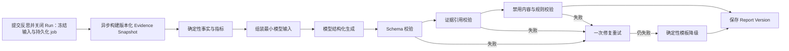

# MajorPilot MVP 报告与证据设计

> 状态：详细设计修订稿 v0.2  
> 更新日期：2026-09-20  
> 适用范围：单专业报告、比较报告、证据快照、模型生成与降级  
> 关联文档：[产品定义](./01-mvp-product-definition.md) · [模型服务评估](./04-model-provider-evaluation.md) · [领域模型](./06-domain-model-and-data-boundaries.md) · [任务设计](./09-three-major-task-designs.md)

## 1. 报告的产品责任

报告帮助学生回顾真实体验并形成下一步问题，不承担以下职责：

- 输出专业适配度总分；
- 判断人格、智力或长期潜力；
- 预测录取、就业或职业成功；
- 把一次短任务表现推广为稳定能力；
- 替学生作最终专业决定；
- 把提示次数、停留时间或错误次数直接解释为能力高低。

报告必须分别呈现：

1. **体验偏好**：以 Reflection 中的学生自述为主；
2. **当前准备度**：以本次任务中可观察的知识和操作为主；
3. **本次任务表现**：限定在当前 Task Version、数据和支持条件下。

## 2. 证据分层

### 2.1 原始领域事实

原始事实包括 Step Response、执行结果、Hint Request 和 Reflection。执行结果区分服务端验证与客户端观察；客户端上报数值不能未经重算就变成准确率或正确性声明。它们仍然需要经过字段白名单和任务规则判断，不能整体发送给模型。

### 2.2 Experience Evidence

Experience Evidence 是从原始事实中提取的结构化、可追溯条目。通用字段包括：

- `evidence_id`：报告可引用的稳定标识；
- `evidence_type`；
- `major`、`task_version`、`experience_run_id`；
- `source_type` 和 `source_reference`；
- `observed_at`；
- `structured_value`；
- `display_summary`：经过审核、可供模型理解的短摘要；
- `allowed_claim_types`；
- `sensitivity_class`；
- `rule_version`。

`display_summary` 不能包含证据中不存在的解释。

2026-09-21工程澄清：Step Response 保存成功只证明学生做出某项选择或写下某段内容，不验证其中预测、分析或因果命题。提取时将可验证操作/配置与 `STUDENT_ANALYSIS`（UNVERIFIED）分开；未经明确版本化规则判读的分析条目 `allowed_claim_types=[]`，不能仅因有 evidence_id 就作为事实或克制解释发布。需要保留“学生提出了两条假设”时，用可核查条数的独立动作事实，不把假设内容升级成事实。`STUDENT_SELF_REPORT` 仍限定 Reflection 中的个人体验，不用来包容所有学生自由文本。

### 2.3 Evidence Snapshot

Experience Run 关闭时固定报告输入 manifest（原始 Decision Profile、Task Version、最终步骤 revision、执行记录和 Reflection 引用及校验值），并同事务写入构建作业；关闭不等待快照或模型。随后异步构建 Evidence Snapshot，只读该 manifest。快照失败不撤销完成状态、不丢失输入，重试追加 snapshot_version_no 并保留失败版本；READY 快照不可更改。后续事件、问卷修改和任务升级都不能替换历史输入。

Evidence Snapshot 只包含生成报告所需的最小信息，不包含密码、令牌、完整事件流、模型密钥或与报告无关的自由文本。

## 3. Report Claim 类型

每个用户可见结论都是一个 Report Claim：

| 类型 | 含义 | 允许依据 | 示例边界 |
| --- | --- | --- | --- |
| `OBSERVED_FACT` | 系统明确记录的动作或结果 | Step Response、执行结果、任务规则 | “你比较了调整前后的两组结果” |
| `STUDENT_SELF_REPORT` | 学生本人明确表达的体验 | Reflection | “你表示错误分析环节最有兴趣” |
| `BOUNDED_INTERPRETATION` | 对多个证据的克制解释 | 至少一个事实和／或自述，且有规则允许 | “这次体验显示你愿意继续尝试这种迭代方式” |
| `LIMITATION` | 当前证据不能回答的内容 | 任务和证据边界 | “一次合成数据任务不能说明长期课程表现” |
| `NEXT_STEP` | 用于继续验证的行动 | 未解决问题、限制和学生目标 | “下一次可以比较数据推理体验” |

所有 `OBSERVED_FACT`、`STUDENT_SELF_REPORT` 和 `BOUNDED_INTERPRETATION` 必须引用一个或多个 `evidence_id`。`LIMITATION` 和 `NEXT_STEP` 至少引用规则版本、未解决问题或相关证据。

## 4. 专业证据白名单

### 4.1 AI

允许进入 Evidence Snapshot：

- 学生归纳的错误模式及对应样本标识；
- 选择或修改的规则、示例和阈值；
- 固定评价集的前后结构化指标；
- 新增和减少的错误类别；
- 上线决定、监控项和学生写明的风险；
- Reflection 自述；
- 提示层级和主题，但不得单独作为能力结论。

禁止把“准确率提高”直接写成“适合 AI”。

### 4.2 Data Science

允许进入 Evidence Snapshot：

- 识别的数据质量问题；
- 数据处理选择和理由；
- 使用的变量、分组、图表或统计结果；
- 学生写出的发现和限制；
- 相关与因果的区分；
- 后续验证问题；
- Reflection 自述。

禁止把某个模型或图表结果直接写成稳定数学能力。

### 4.3 Business Analytics

允许进入 Evidence Snapshot：

- 指标分子、分母和时间窗口；
- 定位的漏斗环节和细分群体；
- 观察、原因假设和未知信息的区分；
- 行动、成功指标、护栏指标和复盘时间；
- Reflection 自述。

禁止把某项商业建议写成真实企业环境中的必然有效方案。

## 5. Experience Report 结构

学生可见顺序固定为：

1. **体验概览**：Major、角色、Task Version、完成日期和支持条件；
2. **你完成了什么**：3–5 条 OBSERVED_FACT；
3. **体验偏好**：只引用 Reflection 和与其一致的行为事实；
4. **当前准备度**：已表现出的概念或操作，以及仍需要支持的部分；
5. **本次任务表现**：专业特有成果、迭代和限制；
6. **专业工作方式连接**：说明任务与常见学习方式的关系，不扩展到职业保证；
7. **证据和结论边界**：明确任务时长、合成数据和支持条件；
8. **另外两个专业的差异**；
9. **下一次体验建议**：规则结果、理由和自由改选入口。

报告顶部持续显示：“这是一次体验总结，不是专业适配度测试或录取判断。”

## 6. Comparison Report 结构

完成至少两个 Major Experience 后生成 Comparison Report：

1. 比较范围和来源 Report Version；
2. 各专业分别完成了什么；
3. 学生自述的兴趣和困难并列比较；
4. 共同维度比较；
5. 专业特有体验；
6. 仍然无法判断的内容；
7. 下一步验证建议；
8. 第三个专业的可选入口。

共同维度只能使用以下类别：

- 对问题类型的兴趣；
- 对定量信息的舒适程度；
- 面对不确定信息的处理方式；
- 对模型、数据或行动决策的关注；
- 遇到困难时的求助和迭代；
- 对解释和表达结果的兴趣；
- 是否愿意继续类似任务。

比较报告不把共同维度汇总成总分或唯一排名。某个维度证据不足时显示“本次尚无足够证据”，而不是填补推断。

## 7. 结构化报告契约

模型输出使用项目定义的结构，概念示例如下：

```json
{
  "reportType": "EXPERIENCE",
  "major": "DATA_SCIENCE",
  "sections": [
    {
      "sectionType": "WHAT_YOU_DID",
      "claims": [
        {
          "claimType": "OBSERVED_FACT",
          "text": "你识别并处理了一个重复记录。",
          "evidenceIds": ["ev_..."],
          "confidence": "DIRECT"
        }
      ]
    }
  ],
  "limitations": [],
  "nextRecommendation": {}
}
```

真实 JSON Schema 在实现阶段由仓库文件管理，但必须满足：

- 不允许模型新增未定义字段；
- `claimType` 使用枚举；
- 引用的 `evidenceIds` 必须存在于当前 Evidence Snapshot；
- 每节声明数量和单条长度有上限；
- 禁止 HTML、脚本、外部 URL 和 Markdown 图片；
- 用户可见文本允许有限 Markdown，但渲染前必须经过白名单处理；
- 推荐 Major 必须等于规则系统结果；
- 模型不能创建分数、人格标签和录取概率字段。

## 8. 生成流水线



流水线要求：

1. 先确定事实和规则结果，再调用模型；
2. 发送模型的数据只来自 Evidence Snapshot；
3. 模型输入记录字段清单和版本，不默认保存完整提示内容；
4. 首次失败后只允许一次有边界的修复重试；
5. 第二次失败使用确定性模板生成基础报告；
6. 确定性模板也通过同一 JSON Schema；
7. 模型故障不会把 Experience Run 改回未完成；
8. 后续人工重试会创建新 Report Version，不覆盖旧版本。

证据失败时显示“体验已完成，报告准备异常”，不得用缺失／虚构证据生成降级报告；只有 READY snapshot 才进入生成。后台失败作业可重试且有告警。AI 故障可降级，不代表证据缺失也能跳过验证。作业重启、租约、删除竞态与幂等发布遵循 `11` §12A、`15` §11.3。

NEXT 规则在关闭事务内基于固定输入生成，不依赖 AI 或报告成功；初次报告引用该推荐 id。两项报告可用后构建比较报告，若其中一项仍在准备，页面显示等待来源，不伪造完成。第三项完成扩展同一个逻辑比较报告的新版本。发布后来源版本即使被替代，也不改写既有比较报告；需更新时另建比较版本。

## 9. 确定性降级报告

降级报告至少展示：

- 体验元数据；
- 已完成步骤；
- 结构化任务结果；
- 学生 Reflection 原意的安全摘要；
- 固定限制说明；
- 规则生成的下一专业建议。

降级模式不生成 BOUNDED_INTERPRETATION，只显示事实、自述、限制和下一步。页面可以说明“部分个性化解释暂不可用”，但不能显示供应商错误、内部提示词或技术堆栈。

## 10. Report Version 与重新生成

- 第一个可用版本成为当前版本；
- 再次生成成功后，新版本成为当前版本，旧版本标记为 Superseded；
- 学生只看到当前版本；
- 内部人员查看旧版本需要专门权限和审计；
- 修改 Decision Profile 不自动重写旧报告；
- Task Version、Evidence Snapshot 或规则不同必须创建新版本；
- 同一次 Run 的 Task Version 和 Decision Profile 永远不换；重生成可用新证据提取规则，但只能从原关闭输入生成新的 snapshot，再创建报告版本；
- 删除账户时一并处理所有 Report Version 和 Evidence Snapshot；
- 打印页面引用当前 Report Version，并在页脚显示版本和生成日期。

## 11. 展示和可访问性

- 结论使用短段落和清楚标题，不展示内部证据 ID；
- 允许学生展开“依据”查看经过筛选的证据摘要；
- 不显示完整事件日志、模型提示词或其他学生数据；
- 颜色不能是事实、自述和解释的唯一分类方式；
- 打印样式保留报告边界说明、版本和日期；
- 报告 URL 使用不可枚举标识，但服务端仍必须验证资源归属；
- 不提供公开分享和无需登录的打印链接。

## 12. 管理端能力

MVP 管理端可以：

- 查看生成状态、失败类型和所用版本；
- 查看结构化校验结果；
- 在有权限和填写原因后触发重新生成；
- 查看脱敏后的证据摘要；
- 将异常标记为待排查；
- 查看模型调用量、耗时和估算成本。

管理端不能：

- 直接编辑学生可见结论；
- 修改学生 Step Response 或 Reflection；
- 手工添加不存在的证据；
- 把失败报告直接标记为成功；
- 绕过重新生成流程覆盖已有 Report Version。

## 13. 报告验收条件

1. 每条事实、自述和解释都能追溯到当前 Evidence Snapshot；
2. 删除一个被引用证据会使验证失败，而不是静默保留结论；
3. 模型返回不存在的 `evidence_id` 时不会发布报告；
4. 模型返回适配度分数、人格或录取判断时不会发布报告；
5. 模型连续失败后仍能生成基础降级报告；
6. 报告失败不改变任务完成状态；
7. 重新生成产生新版本并保留审计记录；
8. 一个学生不能读取另一个学生的 Report Version；
9. Comparison Report 只使用至少两个已完成体验的当前有效来源；
10. 用户页面、打印页面和管理端显示相同的当前版本标识；
11. 报告清楚区分事实、自述、解释、限制和下一步；
12. 报告中不展示完整后台事件、密码、令牌、模型密钥或供应商原始错误。
13. 快照构建失败、进程重启和旧 worker 迟到不会丢失作业、覆盖新版本或撤销体验完成。
14. 修改当前 profile 后重生成旧报告，仍使用该 Run 固定的原 profile；来源报告替代不使历史比较内容漂移。
