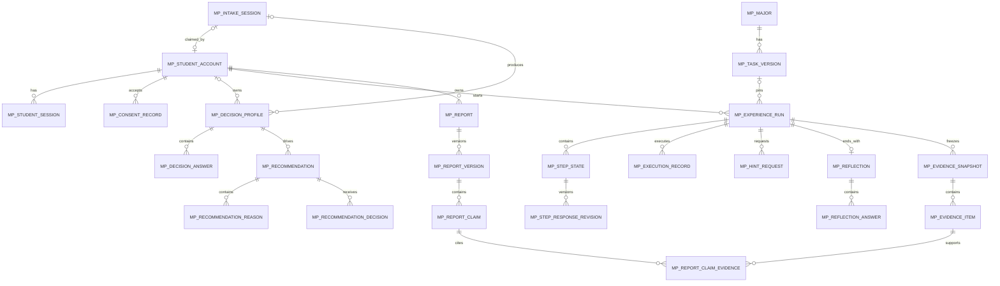

# MajorPilot MVP MySQL 逻辑数据模型

> 状态：详细设计修订稿 v0.2  
> 更新日期：2026-09-20  
> 适用范围：MajorPilot 业务表、关系、约束、索引、版本和删除策略  
> 关联文档：[领域模型](./06-domain-model-and-data-boundaries.md) · [问卷与推荐](./08-intake-and-recommendation-design.md) · [任务设计](./09-three-major-task-designs.md) · [报告设计](./10-report-and-evidence-design.md)

## 1. 数据库原则

2026-11-14：背景资料可空、可部分提交，新增独立学生资料草稿及版本冲突控制，见 [48](./48-profile-dashboard-and-payment-demo.md)。正式 Decision Profile 仍追加不可变；草稿不参与任务和报告。自主开始不要求 source recommendation/decision，使用真实的已提交背景或明确空快照。新资料不得追溯更新既有运行；原报告的固定背景与证据引用保持。旧文中“开始必须有来源推荐”的限制由本补充替代，其他状态及删除规则不变。

- 使用 MySQL 8.4 LTS；
- RuoYi 原有表保持上游命名，MajorPilot 业务表统一使用 `mp_` 前缀；
- `sys_user` 只表示内部操作人员，任何 `mp_student_*` 表都不外键到 `sys_user`；
- 内部主键使用 `BIGINT UNSIGNED`，对学生暴露的资源另有不可枚举 `public_id`；
- 时间使用 UTC 的 `DATETIME(3)`，API 层使用带时区 ISO 8601；
- 状态使用稳定代码和数据库 `CHECK`，不使用难迁移的 MySQL `ENUM`；
- 需要查询、约束或统计的字段单独建列，不把全部业务数据塞入 JSON；
- JSON 只用于版本快照、受控结构化回答和供应商无关结果；
- 关键历史采用追加版本，不覆盖推荐、证据和报告版本；
- Redis 不保存唯一业务事实；
- 所有删除、重置、导出和报告重生成均产生审计记录。

## 2. 通用字段约定

除纯关联表外，业务表通常包含：

| 字段 | 类型 | 说明 |
| --- | --- | --- |
| `id` | `BIGINT UNSIGNED` | 内部主键，不暴露给浏览器 |
| `public_id` | `CHAR(26)` | ULID 形式的外部标识，仍需资源归属校验 |
| `created_at` | `DATETIME(3)` | UTC 创建时间 |
| `updated_at` | `DATETIME(3)` | UTC 最后更新时间 |
| `row_version` | `BIGINT UNSIGNED` | 乐观锁版本，需要并发更新的表使用 |

审计字段按责任区分：

- 学生数据使用 `student_id`；
- 内部操作使用 `operator_id`，值来自 `sys_user.id`，只出现在审计和管理操作字段；
- 自动任务使用 `actor_type = SYSTEM`，不能伪装成内部操作人员。

## 3. 总体关系

## 4. 学生身份与会话

### 4.1 `mp_student_account`

| 关键字段 | 说明 |
| --- | --- |
| `id`, `public_id` | 内外部标识 |
| `email_normalized` | 小写并标准化的邮箱，唯一 |
| `email_display` | 用于显示的原始大小写形式 |
| `password_hash` | 成熟密码哈希的完整编码字符串 |
| `status` | `PENDING_VERIFICATION`、`ACTIVE`、`LOCKED`、`DELETION_PENDING`、`DELETED` |
| `email_verified_at` | 邮箱验证时间 |
| `failed_login_count`、`locked_until` | 基础防撞库状态 |
| `last_login_at` | 最近成功登录时间 |
| `deletion_requested_at`、`deleted_at` | 删除流程状态 |

约束与索引：

- `UNIQUE(email_normalized)`；
- `UNIQUE(public_id)`；
- `CHECK(status IN (...))`；
- 普通页面和 API 不返回 `password_hash`；
- `DELETED` 账户的邮箱处理方式由删除作业执行，不能继续参与登录唯一性判断而阻止合法重新注册；
- 管理员不能直接修改 `password_hash` 或把 `DELETED` 改回 `ACTIVE`。

### 4.2 `mp_student_session`

保存服务端可撤销的学生会话或 refresh token 元数据：

- `student_id`；
- `token_hash`，只保存令牌哈希；
- `status`：`ACTIVE`、`REVOKED`、`EXPIRED`；
- `issued_at`、`expires_at`、`revoked_at`；
- `last_seen_at`；
- 截断后的设备和客户端信息；
- `revoke_reason`。

索引：`UNIQUE(token_hash)`、`INDEX(student_id, status, expires_at)`。退出登录、重置密码和账户删除需要撤销相关会话。

会话绝对有效期7天、空闲24小时失效；密码修改／重置、邮箱变更成功、删除确认和安全锁定撤销全部会话。注销单设备只撤销当前会话。CSRF 的签名、会话绑定和 Cookie Path 以 `12` §4 为唯一协议来源。

### 4.3 `mp_email_token`

用于邮箱验证、邮箱变更和密码重置：

- `student_id`；
- `purpose`：`VERIFY_EMAIL`、`CHANGE_EMAIL` 或 `RESET_PASSWORD`；
- `token_hash`；
- `target_email_normalized`、`target_email_display`：只在 `CHANGE_EMAIL` 时填写；
- `expires_at`、`used_at`；
- `request_ip_hash`；
- `created_at`。

令牌只能使用一次。新令牌产生时可以使同用途旧令牌失效。邮箱变更只有在新邮箱验证成功并重新检查唯一性后才写入 Student Account；旧邮箱在此之前继续有效。数据库不保存明文令牌。

### 4.4 `mp_consent_record`

追加保存：

- `student_id` 或尚未注册时的 `intake_session_id`；
- `document_type`：条款、隐私、可选研究授权；
- `document_version`；
- `decision`：`ACCEPTED`、`DECLINED`、`WITHDRAWN`；
- `decided_at`；
- 受控来源信息。

条款和隐私接受不能被后续更新覆盖。可选研究授权撤回不会影响完成核心服务所需的数据处理。

## 5. Intake Session 与 Decision Profile

### 5.1 `mp_intake_session`

| 字段 | 说明 |
| --- | --- |
| `public_id` | 浏览器持有的匿名流程标识，不是认证凭证 |
| `secret_hash` | 与 public_id 分离的临时认领秘密哈希 |
| `questionnaire_version` | 当前问卷版本 |
| `status` | `DRAFT`、`SUBMITTED`、`CLAIMED`、`EXPIRED`、`PURGED` |
| `draft_json` | 尚未提交的受控草稿 |
| `expires_at` | 创建或最近有效操作后7天 |
| `claimed_student_id` | 注册认领后填写 |
| `claimed_at` | 认领时间 |

约束：

- 一个 Intake Session 最多认领一次；
- `CLAIMED` 后不能切换 Student；
- `public_id` 本身不足以读取内容，需临时 secret；
- 过期清理不删除已经认领到 Student 的 Decision Profile；
- `INDEX(status, expires_at)` 支持清理任务。

### 5.2 `mp_decision_profile`

- `student_id`：注册前允许为空，认领后填充；
- `intake_session_id`：匿名提交必填，注册后直接修改资料产生的新版本可为空；
- `profile_version_no`：用户提交版本从 1 开始，在同一 Student 内递增；0 仅保留为未提供背景时的内部空快照，不作为正式资料、提交事件或资料数量展示；
- `questionnaire_version`；
- `submitted_at`；
- `profile_summary_json`：只保存结构化摘要和支持提示；
- `status`：`SUBMITTED`、`CLAIMED`、`SUPERSEDED`；
- `supersedes_profile_id`。

约束与索引：

- `UNIQUE(student_id, profile_version_no)`，注册前通过 Intake Session 约束；
- `INDEX(student_id, submitted_at)`；
- 已经绑定 Recommendation 或 Report Version 的记录不可物理更新答案。

### 5.3 `mp_decision_answer`

- `decision_profile_id`；
- `question_key`；
- `answer_json`；
- `answer_text_redacted`：只有允许进入解释的短文本才填；
- `schema_version`；
- `created_at`。

`UNIQUE(decision_profile_id, question_key)`。渠道和自由文本可存储，但推荐引擎只读取白名单结构化字段。

## 6. 推荐

### 6.1 `mp_recommendation`

- `student_id`，注册前允许为空；
- `decision_profile_id`；
- `recommendation_type`：`INITIAL`、`NEXT`；
- `source_run_id`：INITIAL 为空，NEXT 必须引用产生本次建议的 Closed Run；
- `completed_major_codes_json`：生成时的已完成集合；
- `rule_version`；
- `primary_major_code`；
- `alternative_order_json`；
- `tie_detected`、`tie_break_rule`；
- `explanation_status`：`STRUCTURED_ONLY`、`AI_READY`、`AI_FAILED`；
- `explanation_version`；
- `generated_at`；
- `idempotency_key`。

约束：

- 使用两个可空生成列 `initial_profile_guard`（INITIAL 时为 profile id）与 `next_source_run_guard`（NEXT 时为 source run id）；分别 `UNIQUE(initial_profile_guard, rule_version)`、`UNIQUE(next_source_run_guard, rule_version)`，不能用同一个 profile 唯一约束阻止第二次 NEXT；
- NEXT 的 Decision Profile 来自 source Run 固定的 profile，不能读取学生之后修改的新版本；候选集合为空时不创建假推荐，由 dashboard 返回 `ALL_COMPLETED`；
- 重复提交相同版本返回同一 Recommendation；
- AI 解释失败不能更改 `primary_major_code`。

### 6.2 `mp_recommendation_reason`

- `recommendation_id`；
- `reason_code`；
- `reason_type`：RANKING、CONTEXT、BOUNDARY；
- `major_code`；
- `reason_order`；
- `source_question_keys_json`；
- `display_text`；
- `rule_version`。

`UNIQUE(recommendation_id, reason_order)`。`display_text` 可以由确定性模板产生；AI 润色结果与规则理由分开保存。

### 6.3 `mp_recommendation_decision`

- `recommendation_id`；
- `student_id`；
- `decision_type`：`ACCEPTED`、`OVERRIDDEN`；
- `selected_major_code`；
- `override_reason_code`；
- `override_text`，可为空；
- `decided_at`。

增加 `decision_no`，`UNIQUE(recommendation_id, decision_no)`，决定追加不可变；最新一条为当前决定。保存决定不创建 Run。随后创建 Ready Run 的接口引用 `source_decision_id`，按学生／专业复用既有运行；开始时固定当次决定，之后不得回写。两步之间断网可重试，不会产生双份 Run。

## 7. 专业和任务内容注册

### 7.1 `mp_major`

保存三个受支持 Major：

- `code`：`AI`、`DATA_SCIENCE`、`BUSINESS_ANALYTICS`；
- 中英文名称；
- 简短说明；
- `display_order`；
- `status`：`ACTIVE`、`INACTIVE`。

`UNIQUE(code)`。Major 不能因停用而删除历史 Experience Run。

### 7.2 `mp_task_version`

- `major_id`；
- `version_code`；
- `status`：`DRAFT`、`REVIEW`、`PUBLISHED`、`RETIRED`；
- `manifest_path`；
- `manifest_sha256`；
- `data_sha256`；
- `content_schema_version`；
- `published_at`、`retired_at`；
- `reviewed_by_operator_id`；
- `review_note`。

约束：

- `UNIQUE(major_id, version_code)`；
- 每个 Major 最多一个供新体验使用的 PUBLISHED 版本，由发布事务保证；
- 发布后 manifest 和数据校验值不可修改；修正内容必须发布新版本；
- Retired 版本仍可服务已绑定的 Experience Run 和历史报告。

## 8. Experience Run 与步骤

### 8.1 `mp_experience_run`

- `student_id`；
- `major_id`、`task_version_id`；
- `source_recommendation_id`、`source_decision_id`，推荐入口创建 Ready 时引用同一学生的不可变决定；自主选择时两者均为空，不制造推荐；
- `decision_profile_id`：创建普通专业 Run 时固定为最新正式背景，未提交背景时使用明确的内部空快照；旧 NEXT 推荐仍保留它自己的原始背景引用。复用、开始或恢复运行沿用该 Run 原 profile，不使用最新资料替换历史；
- `status`：`READY`、`IN_PROGRESS`、`TASK_COMPLETED`、`PAUSED`、`CLOSED`、`REPLACED`；
- `paused_from_status`：仅 PAUSED 时为 IN_PROGRESS 或 TASK_COMPLETED；
- `attempt_no`；
- `origin_run_id`：仅内部恢复生成的新体验使用；
- `created_reason`：`STUDENT_START`、`OPERATOR_RECOVERY`；
- `current_step_key`；
- `started_at`、`task_completed_at`、`reflection_completed_at`、`closed_at`；
- `last_activity_at`；
- `paused_at`、`replaced_at`；
- `closed_input_manifest_json`、`closed_input_sha256`：关闭时固定 profile、task、最终步骤 revision／execution／reflection 引用，之后不可更改；
- `row_version`；
- `active_guard`：仅 IN_PROGRESS／TASK_COMPLETED 为1，其余为 NULL 的生成列；
- `current_major_guard`：非 REPLACED 为1，REPLACED 为 NULL 的生成列。

约束与策略：

- `UNIQUE(public_id)`；
- `UNIQUE(student_id, active_guard)` 保证同一学生同时最多一个活动体验；
- `UNIQUE(student_id, major_id, current_major_guard)` 保证每专业最多一个当前运行，包含 CLOSED，阻止自行重做；
- `UNIQUE(student_id, major_id, attempt_no)`；
- 学生不能自行创建 `attempt_no > 1`；
- 内部恢复必须引用 `origin_run_id`、填写原因并写审计；
- READY 的 task_version_id 可以为空，普通专业新 Run 的 decision_profile_id 在创建时固定；历史尚未绑定背景的 READY 保留原兼容规则。开始后内容和背景均非空且不可改；PAUSED 只恢复原阶段和同一版本，不增加 attempt_no；
- 锁定 Student Account 行后统一处理 start／pause／resume／恢复；切换先将旧活动运行置 PAUSED，再激活目标，两者同一事务；revision 不匹配或目标不可开始则全部回滚；
- 恢复仅允许未完成当前运行：原运行置 REPLACED 释放两个 guard，新建同 Major 的 READY，attempt_no 递增、origin_run_id 必填。只更改原记录状态元数据，不复制／修改学生回答或伪造完成；新恢复运行首次开始默认固定原 Task Version（原记录未开始则取当前发布版）；
- CLOSED 不回退、不替换，报告问题走新 Report Version；
- `INDEX(student_id, status, last_activity_at)`。

### 8.2 `mp_step_state`

- `experience_run_id`；
- `step_key`；
- `status`：`NOT_STARTED`、`IN_PROGRESS`、`COMPLETED`；
- `current_revision`；
- `first_started_at`、`last_saved_at`、`completed_at`；
- `row_version`。

`UNIQUE(experience_run_id, step_key)`。服务器根据 Task Version manifest 验证 step_key 和步骤依赖。

### 8.3 `mp_step_response_revision`

采用追加版本：

- `step_state_id`；
- `revision_no`；
- `response_schema_version`；
- `response_json`；
- `normalized_result_json`；
- `validation_status`；
- `client_saved_at`、`received_at`；
- `content_sha256`。

约束：`UNIQUE(step_state_id, revision_no)`。更新请求必须携带上一版本号；迟到或重复请求不会覆盖更新版本。

### 8.4 `mp_execution_record`

- `experience_run_id`、`step_key`；
- `request_public_id`；
- `engine_type`、`engine_version`；
- `operation_key`、`input_revision`、`trust_level`：`SERVER_VERIFIED` 或 `CLIENT_OBSERVED`；
- `evaluation_config_sha256`：仅 AI 正式评价填写，以 Task Version 与规范化配置计算，不包含解释文本或 revision；
- `input_sha256`；
- `status`：`SUCCEEDED`、`FAILED`、`TIMED_OUT`、`CANCELLED`；
- `result_json`：白名单结构化输出；
- `error_code`：不含堆栈和密钥；
- `duration_ms`；
- `created_at`。

`UNIQUE(request_public_id)` 支持执行幂等。完整任意 stdout、文件或环境信息不进入数据库。

AI 成功评分另受 `UNIQUE(experience_run_id, operation_key, evaluation_config_sha256)` 约束；失败记录该字段为空。完成写入时锁 Run 行，只有成功配置数小于5才新增；相同配置直接复用原成功结果，不因新 revision 重扣次数。复用必须校验当前配置哈希相同，并将复用结果引用绑定到当前 response revision 的 normalized_result，不声称旧执行发生在新时间。

AI 正式评价必须服务端重新计算后标为 SERVER_VERIFIED；CLIENT_OBSERVED 的数值不能直接支持“正确率”等事实声明。执行结束再次检查 Run 仍活动且 input revision 未变，过期结果只留诊断状态，不推进步骤。

### 8.5 `mp_hint_request`

- `experience_run_id`、`step_key`；
- `hint_level`：1、2、3；
- `request_context_json`：白名单上下文；
- `response_json`；
- `provider`、`model`、`prompt_version`；
- `status`：`PENDING`、`SUCCEEDED`、`FALLBACK`、`FAILED`；
- `ai_call_id`；
- `requested_at`、`completed_at`。

索引：`INDEX(experience_run_id, step_key, requested_at)`。提示次数不存为能力分数。

## 9. Reflection

### 9.1 `mp_reflection`

- `experience_run_id`，唯一；
- `question_set_version`；
- `status`：`DRAFT`、`SUBMITTED`；
- `submitted_at`；
- `row_version`。

### 9.2 `mp_reflection_answer`

- `reflection_id`；
- `question_key`；
- `answer_json`；
- `answer_text`；
- `answer_source`：`FIXED_QUESTION`、`AI_FOLLOW_UP`；
- `ai_question_text`，仅在追问时保存；
- `created_at`。

`UNIQUE(reflection_id, question_key)`。跳过可选追问保存显式跳过状态，不能转成负面信号。

## 10. Evidence Snapshot 与报告

### 10.1 `mp_evidence_snapshot`

- `experience_run_id`；
- `snapshot_version_no`；
- `decision_profile_id`、`closed_input_sha256`；
- `task_version_id`；
- `evidence_rule_version`；
- `status`：`BUILDING`、`READY`、`FAILED`；
- `snapshot_sha256`；
- `built_at`；
- `failure_code`。

`UNIQUE(experience_run_id, snapshot_version_no)`；同一 Run 可以有多次构建版本，只有 Closed 才能构建。首次失败版本保留，重试新建版本；READY 后证据内容不可修改。并发构建通过持久化作业的业务键和租约保护，不能把旧作业的迟到结果覆盖新版本。每一版本都只读取该 Run 的 closed input manifest，不读取当前草稿／最新 profile。

### 10.2 `mp_evidence_item`

- `evidence_snapshot_id`；
- `evidence_key`；
- `evidence_type`；
- `source_type`、`source_id`；
- `structured_value_json`；
- `display_summary`；
- `allowed_claim_types_json`；
- `sensitivity_class`；
- `observed_at`；
- `rule_version`。

约束：`UNIQUE(evidence_snapshot_id, evidence_key)`。Evidence Item 追加后不可编辑；构建错误重新产生新的 snapshot 版本需要保留失败记录。

### 10.3 `mp_report`

表示报告逻辑身份：

- `student_id`；
- `report_type`：`EXPERIENCE`、`COMPARISON`；
- `experience_run_id`：EXPERIENCE 必填、COMPARISON 为空；
- `major_id`：Experience Report 使用，Comparison 为空；
- `status`：`PENDING`、`GENERATING`、`READY`、`FAILED`；
- `current_version_id`；
- `requested_at`、`ready_at`；
- `first_ready_at`：首次成功发布后不可变，用于成熟 cohort，重生成不重置；
- `row_version`。

`UNIQUE(experience_run_id)` 保证一次 Closed Run 一个 Experience Report；应用事务验证 student／major 归属一致。增加生成列 `comparison_student_guard`（COMPARISON 为 student_id，否则 NULL），`UNIQUE(comparison_student_guard)` 保证每学生一个 Comparison 逻辑报告；第三项完成增加版本，不新增第二个逻辑比较报告。

### 10.4 `mp_report_version`

- `report_id`；
- `version_no`；
- `status`：`GENERATING`、`READY`、`FAILED`、`SUPERSEDED`；
- `generation_mode`：`AI`、`DETERMINISTIC_FALLBACK`；
- `evidence_snapshot_ids_json`；
- `decision_profile_ids_json`、`source_manifest_sha256`：与各快照一一对应的原始背景和输入，不回读当前资料；
- `next_recommendation_id`：允许为空，第三项完成时没有下一专业；
- `template_version`、`prompt_version`、`model`；
- `structured_report_json`；
- `schema_version`；
- `validation_result_json`；
- `retry_no`：0 或 1；
- `created_at`、`completed_at`；
- `failure_code`。

`UNIQUE(report_id, version_no)`。只有通过所有校验的 READY 版本能成为 `current_version_id`。

### 10.5 `mp_report_claim`

- `report_version_id`；
- `section_key`；
- `claim_order`；
- `claim_type`；
- `claim_text`；
- `confidence_code`；
- `created_at`。

`UNIQUE(report_version_id, section_key, claim_order)`。拆表用于证据验证和内部审计，学生页面仍从经过验证的结构化报告读取。

### 10.6 `mp_report_claim_evidence`

- `report_claim_id`；
- `evidence_item_id`；
- 复合主键。

所有要求证据的 claim 必须至少一条关联。数据库约束不能单独表达这一规则，由报告发布事务验证。

### 10.7 `mp_comparison_source`

- `comparison_report_version_id`；
- `source_experience_report_version_id`；
- `major_id`；
- 复合唯一约束。

新 Comparison Report Version 发布时至少引用两个不同 Major 的当前 READY Experience Report Version，并验证同一 Student。发布后来源绑定不可变；来源以后变为 SUPERSEDED 不使已有比较报告失效，后台可以另排新比较版本，旧版不漂移。恢复运行不把同一 Major 计为两个专业。

## 11. AI 调用、事件、反馈与审计

### 11.1 `mp_ai_call`

只保存运行元数据和最小审计信息：

- `purpose`：推荐解释、提示、反思追问、体验报告、比较报告；
- `provider`、`model`、`endpoint_region`；
- `prompt_version`；
- `input_schema_version`、`input_sha256`；
- `status`、`error_class`；
- `input_tokens`、`output_tokens`、`estimated_cost`；
- `started_at`、`completed_at`、`duration_ms`；
- `correlation_id`。

默认不保存完整供应商请求和响应；正式业务结果存入对应领域表。任何调试采样必须另行配置、脱敏和限期清理。

### 11.2 `mp_product_event`

- `event_id`；
- `client_event_id`、`source_subject_hash`：客户端观察事件使用，主体作用域由服务端生成；
- `event_name`、`event_version`；
- `occurred_at`、`received_at`；
- `student_id` 可为空；
- `intake_session_id` 可为空；
- `experience_run_id`、`task_version_id` 可为空；
- `major_code`、`step_key` 可为空；
- `source`：`STUDENT_WEB`、`ADMIN_WEB`、`BACKEND`；
- `properties_json`：事件白名单属性；
- `dedupe_key`。

索引：

- `UNIQUE(event_id)`；
- `UNIQUE(source_subject_hash, client_event_id)`，客户端重复批次不重复记数；event_id 由后端生成；
- `UNIQUE(dedupe_key)`，允许为空；
- `INDEX(event_name, occurred_at)`；
- `INDEX(experience_run_id, occurred_at)`；
- `INDEX(student_id, occurred_at)`。

### 11.3 `mp_sensitive_audit`

用于 RuoYi 通用操作日志以外的高敏感动作：

- `operator_id`；
- `action_code`；
- `target_type`、`target_public_id`；
- `reason_code`、`reason_text`；
- `before_summary_json`、`after_summary_json`；
- `occurred_at`；
- `correlation_id`。

必须记录：查看敏感报告、导出数据、触发报告重生成、恢复体验、启动删除作业和查看历史报告版本。摘要不复制完整学生内容。

### 11.4 `mp_student_feedback`

保存用户主动提交的产品反馈：

- `feedback_public_id`；
- `student_id`；
- `feedback_type`：`GENERAL`、`TASK`、`REPORT`、`TECHNICAL`；
- `context_type`、`context_public_id` 可为空；
- `major_id`、`task_version_id` 可为空；
- `rating` 可为空，范围1–5；
- `comment_text` 可为空，最长1000字；
- `survey_version` 可为空；
- `answers_json` 可为空，只接受该 survey version 声明的题目和枚举；
- `diagnostic_code` 可为空，只允许服务端白名单；
- `status`：`RECEIVED`、`REVIEWED`、`ARCHIVED`；
- `created_at`、`reviewed_at`。

至少提供评分、评论或版本化问卷答案之一。服务端验证 context 属于当前 Student；表中不复制日志、令牌、模型请求或完整页面状态。报告价值问题使用 `13` 定义的 survey version 和答案白名单。反馈与推荐、报告结论和 Experience Run 完成状态没有事务性副作用。

### 11.5 `mp_student_data_export`

保存学生主动请求的个人数据导出作业：

- `export_public_id`；
- `student_id`；
- `scope`：`REPORTS_ONLY` 或 `FULL_PERSONAL_EXPORT`；
- `status`：`REQUESTED`、`PROCESSING`、`READY`、`FAILED`、`EXPIRED`；
- `format`：MVP 为 `ZIP_JSON_HTML`；
- `object_key`、`file_sha256`、`file_size_bytes`；
- `requested_at`、`completed_at`、`expires_at`；
- `failure_code`；
- `idempotency_key_hash`。

`object_key` 是存储适配器中的逻辑键，不保存开发机绝对路径。导出包只包含学生可理解的数据和报告，不包含密码哈希、令牌、内部风险字段、模型提示词、敏感审计或其他学生数据。下载必须要求当前 Student Session 和资源归属校验，READY 文件默认24小时过期并由清理任务删除。

## 12. 账户删除

### 12.1 `mp_account_deletion_request`

- `student_id`；
- `request_public_id`；
- `status`：`REQUESTED`、`CONFIRMED`、`PROCESSING`、`COMPLETED`、`FAILED`、`CANCELLED`；
- `requested_at`、`confirmed_at`、`scheduled_for`、`completed_at`；
- `failure_code`；
- `receipt_id`、`receipt_secret_hash`、`receipt_expires_at`；
- `current_stage`、`last_attempt_at`，便于断点续做和内部告警。

设计默认值：

- 确认删除后立即把账户置为 `DELETION_PENDING` 并撤销会话；
- 最迟30天内完成删除或不可逆去标识化；
- 处理完成后清空 student_id 等账户关联，只保留 receipt_id、不可反查身份的 secret 哈希、到期时间、处理时间和结果；保存最多90天且不晚于确认后120天；
- 已经不可逆聚合且不能重新识别个人的统计可以保留；
- 公开部署前需要法律和隐私审查确认具体期限。

### 12.2 删除顺序

1. 撤销 Student Session 和 Email Token；
2. 阻止新 Experience Run、报告和导出；
3. 使 Student Data Export 下载失效并删除导出文件；
4. 删除或去标识化自由文本、Step Response、Reflection 和 Evidence；
5. 删除或去标识化 Student Feedback；
6. 删除 Report、Recommendation、Decision Profile 和 Intake 关联；
7. 去标识化 Product Event；
8. 处理 Student Account 的邮箱和凭证；
9. 写入无个人内容的完成凭证。

删除失败必须可重试，并在管理端显示阶段，不能把部分删除标记为完成。

删除确认与所有业务作业发布结果都锁定同一账户行；作业在开始与提交结果前检查账户状态。确认后取消非删除作业，迟到模型／导出／快照结果必须丢弃，不得把已经删除的内容写回来。后台事件、幂等记录、工作队列及可关联错误元数据也属于清理范围。回执状态查询使用 `12` 的专用 Cookie，不依赖已撤销学生会话。

## 12A. 持久化作业与幂等

### `mp_background_job`

- `job_type`：EVIDENCE_BUILD、REPORT_GENERATE、COMPARISON_GENERATE、STUDENT_EXPORT、ADMIN_EXPORT、ACCOUNT_DELETE、RETENTION_CLEANUP；
- `business_key`（唯一）、`owner_student_id`（系统／管理任务可空）、`target_type`、`target_id`、`target_version`；
- `status`：PENDING、RUNNING、RETRY_WAIT、SUCCEEDED、FAILED、CANCELLED；
- `attempt_count`、`available_at`、`lease_until`、`lease_version`、`worker_id`；
- `checkpoint_json`：仅阶段与资源引用，不复制用户内容或供应商请求；
- `last_error_code`、`started_at`、`completed_at`。

业务状态与对应 job 同事务落 MySQL，不依赖进程内队列或 Redis 发一次消息。单体定时 worker 领取任务；租约过期可再领取，完成写入须匹配 lease_version，防止旧 worker 回写。普通任务暂时故障最多自动执行3次，等待5秒／30秒；超限可审计重试。ACCOUNT_DELETE 持续按阶段重试并告警，不能因普通重试上限永久搁置。AI 内容修复只允许一次，与作业基础设施重试不是同一计数。

证据构建每次实际尝试追加 snapshot version；租约过期接管时，将上次未完成 BUILDING 标为 FAILED（LEASE_EXPIRED），再建新版本，旧 worker 不能提交。报告任务绑定明确 report version，保存阶段检查点避免重复发布。删除阶段幂等执行；各类型 job 的业务键分别以 Run+关闭输入哈希、Report+version、Export request id、Deletion request id、清理时间窗口组成。成功元数据保留30天，失败90天，删除账户时先行清理可关联内容；ACCOUNT_DELETE 的最终状态转入去标识化回执。

### `mp_idempotency_record`

`owner_student_id`／`owner_intake_session_id`（用于定向删除）、`scope_hash`、`key_hash`、`request_hmac`、`status`（PROCESSING／COMPLETED）、`resource_type`、`resource_id`、`safe_response_json`、`expires_at`；`UNIQUE(scope_hash, key_hash)`。scope 包括服务端主体、方法、标准化资源路径。注册／登录响应只保存资源引用，不保存凭证、密码或 Set-Cookie。和领域写入同事务提交；事务回滚则不留下永久 PROCESSING。记录24小时后清理，但运行、认领等数据库业务唯一约束不会到期。认领时建立其账户归属，删除时按归属清理，不能仅有不可反查的 scope hash 而无法定位记录。

## 13. 数据保留默认值

| 数据 | MVP 默认 |
| --- | --- |
| 未认领 Intake Session | 最近有效操作后7天删除 |
| Email Token | 到期后7天删除 |
| 已撤销 Student Session | 撤销后30天删除 |
| AI 调用元数据 | 90天，评估后调整 |
| Product Event 明细 | 180天，之后只保留不可逆聚合 |
| 报告和体验数据 | 账户存续期间保留，或由学生主动删除 |
| 用户反馈 | 账户存续期间保留，删除账户时删除或去标识化 |
| 学生个人导出文件 | READY 后24小时，元数据30天 |
| 删除完成凭证 | 完成后90天 |
| 内部敏感操作审计 | 180天，公开部署前复核 |

这些是本地 MVP 设计默认值，不构成未来公开服务的法律保留政策。

## 14. 事务与并发边界

必须在一个数据库事务中完成：

- 注册账户并认领 Intake Session；
- 提交 Decision Profile 并创建确定性 Recommendation；
- 保存不可变 Recommendation Decision；创建／复用 Ready Run 是后续独立幂等事务，不重复记录决定；
- 首次开始 Experience Run 并固定 Task Version；
- 保存 Step Response Revision 并推进 current revision；
- 暂停旧 Run 并首次开始／恢复目标 Run；
- 完成 Reflection、关闭 Experience Run、固定输入引用、生成确定性 NEXT（候选非空时）、创建 PENDING Experience Report 和 Evidence Build Job；
- 发布通过验证的 Report Version 并更新 current version；
- 管理员将未完成旧 Run 置 REPLACED、新建恢复 Run 和对应 Sensitive Audit；
- 确认账户删除、撤销全部会话并持久化删除 Job。

模型调用和浏览器执行不能保持数据库长事务。先提交领域状态，再通过可重试作业更新结果。

## 15. 数据模型验收

1. `sys_user` 与 `mp_student_account` 没有账户复用或隐式权限关联；
2. 相同邮箱可分别存在 Student Account 和 Operator Account，但令牌不能串用；
3. 一个 Intake Session 不能被两个 Student 认领；
4. 同一 Student 同时最多一个活动 Experience Run；暂停、恢复和切换不丢失进度；
5. 已开始的 Experience Run 始终引用同一 Task Version；
6. 迟到自动保存不能覆盖更新 revision；
7. 清空 Redis 后 MySQL 中的进度、推荐、证据和报告仍存在；
8. Report Claim 不能引用其他 Student 的 Evidence Item；
9. 失败 Report Version 不能成为 current version；
10. 删除处理可以重复执行且不会恢复已删除数据；
11. Product Event 不包含完整自由文本、代码、令牌或密钥；
12. 管理员恢复、导出和报告重生成均有 Sensitive Audit；
13. 所有历史推荐、Task Version 和 Report Version 可以解释当时使用的规则和内容；
14. 公开标识不可代替服务端资源归属检查；
15. MySQL 约束、应用事务和并发测试共同覆盖不能单靠数据库表达的规则。
16. 快照失败后可追加新版本；报告通过明确的 run/profile/snapshot 引用复现历史输入。
17. 进程在领域事务提交后退出，重启仍能处理 job；租约过期的旧 worker 无法发布结果。
18. 删除确认与异步完成竞态不会恢复个人数据；回执不授予正常账户权限。
