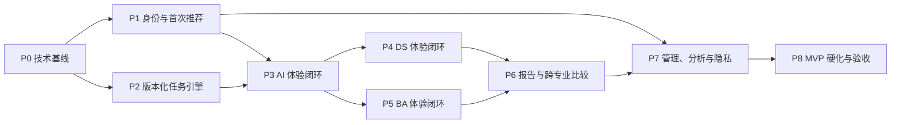

# MajorPilot MVP 实施路线与需求追溯

> 2026-09-24 用户授权的内容质量重设计见[38](./38-method-led-experience-redesign.md)至[41](./41-excel-download-and-local-results.md)。范围是P2–P6的案例、过程证据、报告与下载交互修订；当前只交付设计，不推进P8。后续须先完成内容审阅及新增合同／迁移设计，再按BA纵向闭环、DS与AI复用的顺序验证，不能把既有里程碑通过当作新版本验收。

> 状态：实施拆分修订稿 v0.2  
> 更新日期：2026-09-21
> 适用范围：交给开发团队的里程碑、依赖、出口和需求追踪  
> 关联文档：[产品定义](./01-mvp-product-definition.md) · [设计完成标准](./07-design-stage-definition-of-done.md) · [API 契约](./12-api-contract-design.md) · [工程与测试设计](./15-engineering-and-test-design.md)

## 1. 路线原则

- 先证明技术和安全边界，再扩展产品功能；
- 每个里程碑都形成可运行、可验证的纵向切片，不按“先写完全部后端、再写前端”交付；
- AI、邮件、浏览器执行和内容都通过适配器或版本化合同接入；
- 产品事实保存在 MySQL，Redis、前端状态和分析事件都不是唯一事实来源；
- 每个里程碑只有在自动验证与人工验收证据同时存在时才算完成；
- “能启动”不等于“功能完成”，“接口返回 200”不等于“业务闭环可用”；
- 公网部署、商业化和扩展专业不进入本路线。

## 2. 里程碑依赖

P4 和 P5 可以并行，但都要复用 P2/P3 已验证的内容合同、运行状态机、工作区和证据流水线。不得为三个专业复制三套互不兼容的业务流程。

## 3. P0：技术基线和风险 spike

实施证据入口：[2026-09-20 P0 记录](./20-p0-implementation-evidence.md)：本地技术基线实施与约定范围验证已完成。P1 的后续实施状态见下一节；保留风险、替代方案和同机复现的边界以实际记录为准。

### 目标

证明选定的 RuoYi、双前端、本地基础设施、身份隔离和受限执行方案可以作为真实实施底座。

### 范围

- 固定并记录后端和管理端上游 commit；
- 建立目录、Maven Wrapper、Node/npm 固定文件和 lockfile；
- 建立 MySQL、Redis、邮件捕获器和环境文件加载；
- 执行 RuoYi 原始构建、登录与最小安全裁剪；
- 新建 `ruoyi-majorpilot` 与一个 `mp_` 示例迁移；
- 建立学生/管理两类最小主体和 API 隔离；
- 用真实浏览器验证公共认领、学生退出、两类 CSRF 和限定删除回执 Cookie 的发送路径；
- 完成浏览器执行引擎 spike；
- 完成 Bailian 账号能力 spike：小量真实调用验证区域、模型与结构化输出，本地故障注入验证超时和 429 处理；按 2026-09-20 用户确认，真实容量压测留到上线前，不为 P0 刻意耗尽额度；
- 建立 OpenAPI、JSON Schema、测试和日志骨架；
- 验证 MySQL 持久化 job 的领取、租约、重启恢复和迟到结果拒绝；
- 建立本地检查、启动和停止入口。

### 出口证据

- `15` 第 17 节全部检查有命令、输出摘要和未通过项记录；
- 学生主体调用管理 API 与管理主体调用学生私有 API 均被拒绝；
- 前端构建产物、日志和 Git 跟踪文件中没有测试密钥；
- 空库可以从迁移重建，进程重启后示例数据仍在；
- Chrome 和 Edge 的执行 spike 有冷启动、超时、网络/文件隔离结果；
- 如果任一核心风险不通过，形成替代方案评审，而不是进入业务开发。

## 4. P1：身份、Intake 和首次推荐

实施证据：[P1 交付记录](./21-p1-implementation-and-delivery.md)、[视觉验收](./22-p1-visual-direction.md)。2026-09-20 用户明确选择「本轮规则解释即可，AI 润色列为后续增强」；原计划的真实 AI 润色因此不再作为本轮出口门禁，不以模拟端口测试冒充已接入供应商。其余产品范围不变。

### 目标

交付“首页 → 信息收集 → 注册前推荐 → 注册认领 → 选择首项体验”的完整纵向切片。

### 范围

- 公共首页、说明、隐私摘要、登录和恢复入口；
- 12 页 Intake、匿名会话、自动保存和 7 天过期；
- Decision Profile 与确定性推荐规则；
- 推荐理由代码与确定性文案；按上述确认，真实 AI 润色单列后续增强；
- 注册、邮箱验证、登录、退出、密码重置；
- 将一个未认领 Intake 一次性绑定至学生账户；
- 接受推荐、自由改选和可选改选原因；
- 个人主页的三个专业初始状态；
- 相关事件、审计、速率限制和负向权限测试。

### 出口证据

- `08` 的规则黄金样例全部通过；
- 注册失败、验证中断、重复提交和过期 Intake 都不产生错误绑定；
- 推荐页在注册前显示真实专业和 2–4 条有类型的排序／背景／边界说明，不虚构依据；
- AI 不可用时结果、注册和开始体验仍可继续；
- 两个学生账户之间的 Intake、推荐和资料不可互读；
- 产品、API、数据和事件合同对应的测试全部通过。

## 5. P2：版本化任务引擎与通用工作区

2026-09-21本地实施与验收通过，证据见 [P2–P6交付记录](./23-p2-to-p6-delivery-ledger.md) 和 [工作区视觉验收](./24-p2-workspace-visual-direction.md)。非专业演示与正式AI/DS/BA严格分离，不代表后续专业任务已经开放。

### 目标

在不绑定某个专业细节的前提下交付任务内容发布、运行状态、步骤保存、受限执行、提示和恢复能力。

### 范围

- 内容 manifest、schema 校验、引用校验和发布状态；
- Major、Task Version、Experience Run 和步骤状态机；
- 一名学生同一时刻最多一个活动运行；
- 支持跨专业原子暂停切换、原进度恢复、反思暂停及旧标签页写入拒绝；
- 三栏桌面工作区、任务介绍、移动端限制提示；
- 带 revision 的自动保存、冲突提示和本地草稿恢复；
- Web Worker 执行适配器、超时和允许结果验证；
- 固定提示和 AI 分层提示；
- 运行刷新、重启、Redis 丢失和 Worker 崩溃恢复；
- 内容撤回、旧运行绑定和审计恢复运行。
- 恢复仅替换未完成 Run，CLOSED 报告问题不通过伪造新完成处理；
- 本地草稿按账户／运行隔离，退出／换账号清理，7天 TTL。

### 出口证据

- 一个非专业化演示任务能从开始、保存、执行、提示到完成；
- 双标签页旧 revision 不覆盖新答案；
- 重复开始和重复提交不产生重复运行或副作用；
- 清空 Redis 后可从 MySQL 恢复业务状态；
- 执行环境无法访问任意网络、本地文件或服务端秘密；
- 内容更新不改变已开始运行的 Task Version。

## 6. P3：Artificial Intelligence 体验闭环

### 目标

交付首个真实 45–60 分钟专业体验，并验证完整证据与报告输入链路。

### 范围

- LumenLearn 共用情境、AI 任务内容和合成数据；
- 文本分类输出检查、失败模式、有限调整和前后比较；
- 实现 `09` §5.4A 教学分类器、公开练习预览、服务端隐藏集评分及输入／结果黄金测试；
- 准确率以外的风险与使用边界；
- 三层提示、错误恢复和无编程基础说明；
- 任务后反思及有限追问；
- AI 专业 Evidence Snapshot 和可用声明输入；
- 完成状态、报告生成排队状态和失败状态。

### 出口证据

- 专业内容审核记录完成；
- 零 Python 经验测试用户可按材料完成基础路径；
- 黄金数据产生 `10` 规定的 AI 证据；
- 用户代码/参数错误不会丢失答案或破坏运行；
- 提示不直接提交核心答案；
- 全流程可以在目标时间内完成，超时点有实际观察记录。

## 7. P4：Data Science 体验闭环

### 目标

在通用任务引擎上交付数据质量、关系分析和不确定性表达的真实体验。

### 范围

- DS 合成数据、数据字典和质量问题；
- 清理/转换、关系探索、假设检查、图表或简单统计；
- 不能推出的因果结论和限制；
- DS 特有提示、反思和 Evidence Snapshot；
- 与 AI 任务共享的流程、组件和事件保持一致。

### 出口证据

- 专业内容审核和固定样例通过；
- 关键清理步骤、图表与判断能够追溯；
- 报告不能把相关关系写成因果事实；
- 无代码基础用户可使用模板和说明完成基础路径；
- 任务在目标时间和目标浏览器内完成。

## 8. P5：Business Analytics 体验闭环

### 目标

交付从业务问题到指标、分群、优先级和行动实验的真实体验。

### 范围

- BA 漏斗/课程群体数据和业务约束；
- 问题拆解、指标选择、分群、重点变化和现象/原因区分；
- 行动建议、验证方案和后续指标；
- BA 特有提示、反思和 Evidence Snapshot；
- 与另外两个专业共用的情境差异说明。

### 出口证据

- 专业内容审核和固定样例通过；
- 用户必须说明行动依据与验证指标，不能只选择图表；
- 报告区分已观察现象、推测原因和建议行动；
- 任务在目标时间和目标浏览器内完成；
- 共用组件没有牺牲 BA 的业务判断核心。

## 9. P6：报告、下一专业与比较

2026-09-21本地工程验收通过，提交 `fb030ac4cd5b9cb542ac5ffa9bec62a1174b0c0c` 已推送并核对远端main完整SHA。真实HTTP、双浏览器、实际PDF、三处JVM重启恢复和合成供应商验证见 [P2–P6交付记录](./23-p2-to-p6-delivery-ledger.md)。正式链路用隔离TEST_FIXTURE验证，不代替真实专业内容审核。

### 目标

把一个或两个专业体验转化为私有、可解释、证据可追溯的决策材料。

### 范围

- 完成时冻结输入 manifest，持久化作业异步追加 Evidence Snapshot 版本，失败可恢复；
- 报告结构化生成、schema 校验、证据链接和确定性回退；
- 体验偏好、当前准备度和本次表现分开呈现；
- 另外两个专业的差异与下一专业推荐；
- 用户自由改选；
- 两项完成后的比较报告，第三项完成后扩展同一报告；
- 网页打印样式、反馈入口和生成状态恢复；
- 旧报告版本与原始 profile/task/evidence 绑定。
- 快照失败、作业重启、报告替代、比较来源替代和删除竞态均有测试；

### 出口证据

- 每个报告声明都属于允许类型并有证据或明确标记未知；
- 无证据、越界推断和错误 JSON 样例不会发布；
- AI 失败一次修复后能进入确定性报告，体验仍算完成；
- 学生 A 无法读取学生 B 报告；
- 两个专业完成后比较报告自动可用且无总排名；
- 历史报告在规则或任务升级后内容不漂移。

## 10. P7：管理、分析、支持与隐私

2026-09-21本地工程验收通过，真实HTTP、Chrome/Edge及手机设置页、两处JVM崩溃恢复、指标实库对账、V8迁移及最终冻结回归均已取得证据；Git交付状态见 [P7台账](./35-p7-delivery-ledger.md)。[工程合同](./33-p7-engineering-plan.md)固定实现边界，[视觉记录](./34-p7-visual-contract.md)区分概念、mock与真实页面。本轮授权范围止于P7，P8尚未启动；三专业内容仍REVIEW。

### 目标

交付足以验证产品、排查问题和满足基本数据权利的内部能力，不扩张为通用运营平台。

### 范围

- 独立 RuoYi 管理登录、菜单和细粒度权限；
- 运行概览、漏斗、专业/版本筛选、错误与中断；
- 用户和体验查询、内容版本查看与发布；
- 假名化 CSV 导出及导出审计；
- 敏感报告/自由文本查看权限和审计；
- 支持人员创建有理由的恢复运行；
- 用户数据说明、研究同意撤回、个人报告或完整个人数据导出；
- 删除账户、会话立即撤销、30 天处理；
- 7 天匿名 Intake、事件留存和后台清理任务；
- 匿名／学生事件接收 API，客户端白名单、去重、归属与缺失观察说明；
- 删除后的专用只读回执、异步写入阻断和本地草稿清理；
- 指标质量检查和运行健康状态。

### 出口证据

- `13` 定义的三个核心 KPI 可由事件和业务表复算；
- 概览数值能与数据库样本逐项核对；
- 通用导出不含敏感自由文本或直接身份字段；
- 无权限操作者无法查看、导出或创建恢复运行；
- 删除、导出和同意撤回有端到端证据；
- 支持人员无法编辑原始答案或伪造完成状态。

## 11. P8：MVP 硬化与本地验收

### 目标

证明所有设计要求在目标本地环境形成一个可重复、基础功能达标的 MVP。

### 范围

- 全部功能回归、负向安全、内容合同和迁移测试；
- 从空环境启动、备份、恢复和重启演练；
- Chrome 主验收、Edge 兼容、移动端阅读和报告检查；
- 性能、限流、AI/邮件故障和离线恢复演练；其中真实模型账号容量压测是上线前门禁，执行前需确认预期负载、平台配额和费用上限；
- 无障碍基础检查、中文与英文术语校对；
- 默认账户、演示接口、无关菜单和弱 secret 清理；
- 日志、前端产物、仓库和导出文件的秘密/敏感数据扫描；
- 已知限制、运行手册、测试证据和交付说明。

### 出口证据

- `01` 第 15 节全部 14 项验收有通过或明确失败证据；
- `02` 第 18 节全部页面验收完成；
- `03` 第 10 节技术验收完成；
- `12`、`13`、`15` 的安全、隐私和工程验收完成；
- 新环境可按文档启动，备份恢复后用户进度与报告一致；
- 没有 P0/P1 级阻断缺陷；其他已知问题有影响、绕行和责任归属；
- 明确写明“本地 MVP 已验收”，不把它表述为“公网生产就绪”。

## 12. 功能需求追溯矩阵

编号用于实施和测试引用，不改变 `01` 中的产品语言。

| 编号 | 必需功能 | 设计来源 | API/数据主要来源 | 交付里程碑 | 核心验收 |
| --- | --- | --- | --- | --- | --- |
| FR-01 | 首页和基础说明 | `01` §2–3、`02` §5、`14` | 公共静态内容 | P1 | 用户理解时长、三个专业、报告与非适配分数边界 |
| FR-02 | 基本信息收集 | `01` §5、`02` §6、`08` | `12` Public Intake；`11` Intake/Answer | P1 | 3–5 分钟、12 页、自动保存、7 天过期 |
| FR-03 | 透明首项推荐 | `01` §6、`08` | Recommendation/Reason/Decision | P1 | 规则可复现、理由可追溯、无 fit score |
| FR-04 | 注册登录与恢复 | `02` §8、`12` | Identity API；student/session/token/consent | P1 | 验证、重置、认领、撤销、速率限制 |
| FR-05 | 自由选择专业 | `01` §4/6、`08` | Decision API；override | P1 | 可接受或改选，原因可选 |
| FR-06 | AI 固定任务 | `01` §7.2、`09` | Experience API；AI task version | P3 | 完整运行、错误分析、迭代和边界 |
| FR-07 | DS 固定任务 | `01` §7.3、`09` | Experience API；DS task version | P4 | 质量、关系、假设、不确定性 |
| FR-08 | BA 固定任务 | `01` §7.4、`09` | Experience API；BA task version | P5 | 指标、分群、行动与验证 |
| FR-09 | 内置任务工作区 | `01` §8–9、`02` §10–11、`14` | Run/Step/Execution API | P2 | 三栏、设备限制、可返回和状态明确 |
| FR-10 | 受限执行 | `03` §4、`09`、`15` §10 | execution 表/端点 | P2 | Worker、超时、无任意网络/文件、服务端校验 |
| FR-11 | 自动保存、暂停切换和恢复 | `02` §11、`06`、`12` | run、step state/response revision | P2 | 原子切换、同一进度、旧标签页拒写、草稿账户隔离 |
| FR-12 | AI 分层提示 | `01` §10、`09`、`12` | Hint API；hint request | P2/P3 | 主动触发、逐层、上下文最小化、不泄题 |
| FR-13 | 任务后反思 | `01` §10、`02` §12、`09` | Reflection API/table | P3–P5 | 核心问题、有限追问、可跳可选项 |
| FR-14 | 单专业报告 | `01` §12、`02` §13、`10` | Report API；snapshot/claim/version | P6 | 私有、三维分离、声明有证据、失败回退 |
| FR-15 | 下一专业推荐与改选 | `01` §4.3/13、`08`、`10` | Next Recommendation API | P6 | 排除已完成项、解释差异、允许改选 |
| FR-16 | 比较报告 | `01` §13、`02` §14、`10` | Comparison API/report sources | P6 | 两项后生成、无总排名、第三项扩展 |
| FR-17 | 用户反馈 | `01` §14、`14` | `12` Feedback API；`11` student feedback | P6 | 报告与全局入口可提交，错误不丢失 |
| FR-18 | 结构化运行记录 | `01` §12.2、`11`、`12` §9.1、`13` | event、run、response、evidence | P1–P7 | 接收与去重、版本关联、观察／事实分离、不直接展示原始事件 |
| FR-19 | 管理员分域与权限 | `02` §3.5/16、`03` §6、`12` | sys_user 与 mp_student_account；Admin API | P0/P7 | 登录和令牌隔离、细粒度权限、审计 |
| FR-20 | 基础运行概览与查询 | `02` §16、`13` | Admin API；event/业务表 | P7 | 漏斗可复算、筛选正确、状态可追溯 |
| FR-21 | 受控 CSV 导出 | `02` §16、`12`、`13` | Admin export/audit | P7 | 假名化、字段白名单、权限与用途审计 |
| FR-22 | 账户与数据设置 | `02` §15、`13` | Privacy API；consent/data export/deletion | P7 | 邮箱、密码、同意、个人导出、删除、退出完整 |
| FR-23 | 错误处理与监控 | `03` §10、`12`、`14`、`15` | error contract、日志、health | P0–P8 | 可理解、可恢复、依赖状态真实、无秘密 |

## 13. 跨领域约束追溯

| 编号 | 约束 | 主要设计 | 验证阶段 |
| --- | --- | --- | --- |
| NFR-01 | 单项体验 45–60 分钟 | `01` §8、`09` | P3–P5 人工计时 |
| NFR-02 | 中文界面与准确英文术语 | `01` §15、`09`、`14` | P3–P8 内容审核 |
| NFR-03 | 私有报告和资源归属 | `03` §6、`10`、`12`、`13` | P6/P8 越权测试 |
| NFR-04 | 学生/管理员身份分域 | `03` §6、`06`、`11`、`12` | P0/P7 负向测试 |
| NFR-05 | 任务和报告版本可追溯 | `06`、`09`、`10`、`11` | P2/P6 历史稳定性 |
| NFR-06 | 进度持久化不依赖 Redis | `03` §8、`11`、`15` | P2 Redis 清空测试 |
| NFR-07 | AI 失败可降级 | `04`、`10`、`15` | P1/P6 故障注入 |
| NFR-08 | API Key 仅后端环境文件 | `03` §7、`13`、`15` | P0/P8 secret scan |
| NFR-09 | 最小数据、留存和删除 | `11`、`13` | P7/P8 时间与删除测试 |
| NFR-10 | Chrome 主支持、Edge 兼容 | `03`、`14`、`15` | P0/P8 浏览器矩阵 |
| NFR-11 | 本地 macOS 可重复运行 | `03`、`15` | P0/P8 新环境复现 |
| NFR-12 | 无适配分数、录取预测和人格推断 | `01`、`08`、`10`、`13` | P1/P6 内容和报告合同 |
| NFR-13 | 分析数据不直接成为报告证据 | `06`、`10`、`13` | P6 证据白名单测试 |
| NFR-14 | 幂等、并发和乱序保护 | `11`、`12`、`15` | P1/P2 集成测试 |
| NFR-15 | 无工作人员介入的正常主路径 | `01` §3/15 | P8 全流程验收 |

## 14. 非目标保护

以下需求一旦出现在实施任务中，需要产品负责人明确批准范围变更，而不是顺手加入：

- 院校/项目推荐、录取概率和申请材料评估；
- 支付、订单、咨询预约和销售评分；
- 通用 Notebook、任意代码执行或上传任意文件；
- AI 动态生成完整任务或无审核发布内容；
- 把学生加入 `sys_user` 或让管理令牌直接模拟学生；
- 公共报告链接、社交分享或默认 PDF 导出；
- 微服务、Kubernetes、消息队列和为未来规模预建的分布式系统；
- 全球地区、更多专业和多语言的内容扩张；
- 在当前路线中完成公网部署和商业化上线。

## 15. 需求变更流程

1. 描述用户问题，不先指定技术方案；
2. 标出受影响的 FR/NFR、页面、API、数据、事件、隐私和内容版本；
3. 判断是否改变已冻结的运行或报告含义；
4. 更新设计与验收，再创建实施任务；
5. 如果是内容变化，发布新 Task/Rule/Prompt Version，不改写旧版本；
6. 如果是数据迁移，新增迁移并设计历史数据语义；
7. 保存变更原因、批准人和验证证据。

## 16. 单个实施任务的 Definition of Ready

一个开发任务开始前必须具备：

- 对应 FR/NFR 或已批准缺陷；
- 清楚的用户/操作者和成功结果；
- 页面状态或 API 合同；
- 数据所有权、版本和权限规则；
- 正常、失败、重复和越权验收样例；
- 不在范围内的事项；
- 依赖已完成或有明确模拟接口。

缺少这些信息时应先补设计，不让开发者自行猜测产品语义。

## 17. 单个实施任务的 Definition of Done

- 实现符合现有合同，或合同变更已先更新并评审；
- 自动测试覆盖正常、边界、恢复和授权；
- 相关迁移、OpenAPI、schema、事件和文档同步；
- 本地人工验收通过并记录使用的版本/浏览器；
- 日志、构建产物和导出无秘密或越界敏感数据；
- 没有静默吞错、伪造成功或依赖手工修库的正常路径；
- 已知未验证项明确写出，不把模拟服务结果当真实供应商验收；
- 可以从需求编号追溯到代码变更和测试证据。

## 18. 风险登记与决策触发器

| 风险 | 早期信号 | 当前控制 | 需要重新讨论的触发器 |
| --- | --- | --- | --- |
| RuoYi 基线兼容性 | JDK/MySQL/Redis/前端构建失败 | P0 固定版本与原样验证 | 需要大幅修改通用模块或安全模型 |
| 浏览器执行性能 | 冷启动过长、内存高、Edge 不一致 | Worker spike、适配器和预计算回退 | 无法在合理设备上完成核心步骤 |
| AI 输出不可靠 | schema 失败、无证据结论、延迟高 | 校验、一次修复、确定性回退 | 回退仍无法提供有用报告 |
| 任务超时或过难 | 大量卡在同一步、提示层级过高 | 内容审核、计时测试、事件漏斗 | 多数目标用户无法在 60 分钟内完成 |
| 推荐被误解为定论 | 用户认为是适配评分或录取建议 | 明示边界、无分数、允许改选 | 用户研究持续显示误解 |
| 数据过度采集 | 事件属性持续扩张、导出含自由文本 | 白名单、分级、审计和留存 | 新用途超出运行/分析必要性 |
| 身份串用或越权 | 学生 token 命中管理端、IDOR | 两条安全链、资源归属负向测试 | 无法在 RuoYi 内清晰隔离主体 |
| 内容版本漂移 | 旧报告变化或运行读到新内容 | 不可变版本、Evidence Snapshot | 现有模型无法解释历史记录 |

以上触发器出现时需要方向确认；普通缺陷修复、合同内实现细节和已设计的回退路径无需再次征求产品方向。
