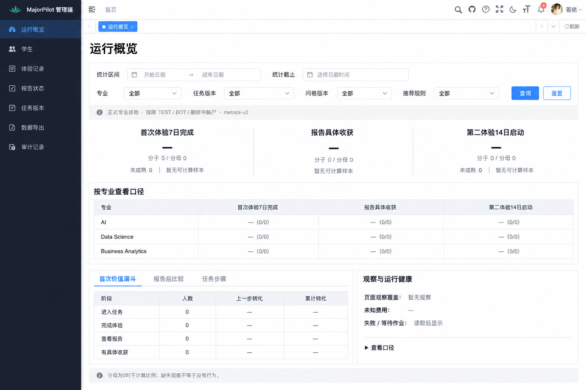
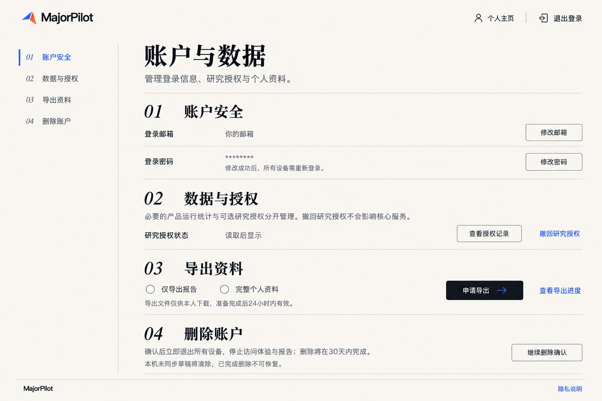
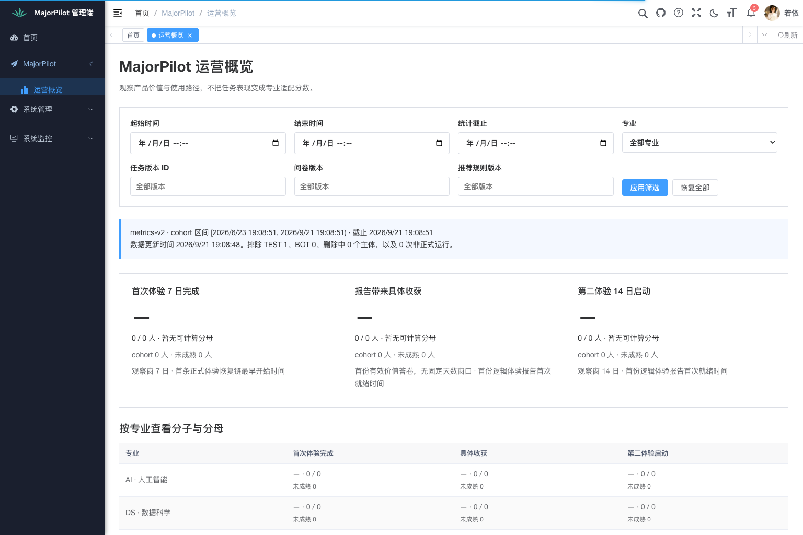
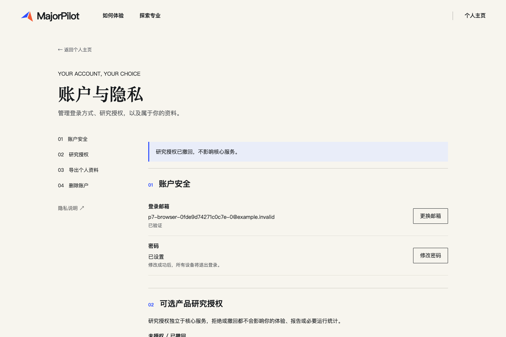
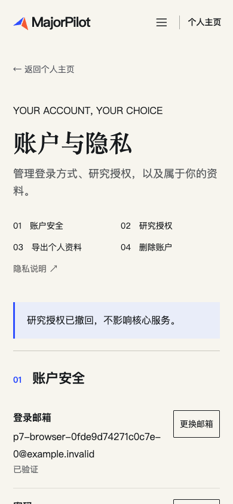
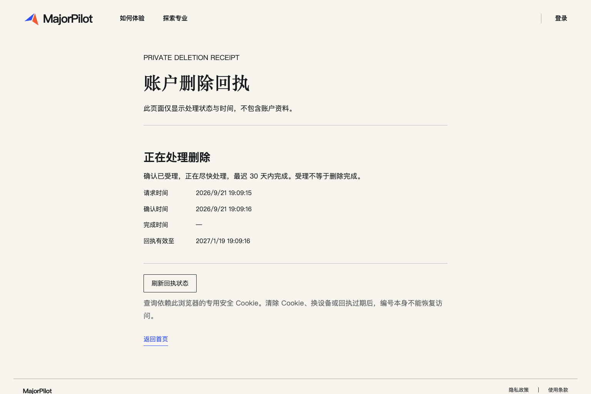

# P7 运营与账户隐私：视觉合同和验证记录

状态：设计参考、Vue实现及Chrome/Edge真实业务浏览器验收通过；Git交付状态见[台账](./35-p7-delivery-ledger.md)。2026-09-21。

## 设计方向

延续已确认的编辑式学生界面：暖纸色、墨黑文字、清晰编号、蓝橙点缀和有呼吸的版面。账户页属于个人资料管理，不做营销冲刺或默认勾选；危险操作用说明、当前密码与确认表达后果，不用视觉压力推动删除。

运营端保留已批准的 RuoYi Vue 架构和真实权限菜单，以信息层级、薄分隔线和可核查口径提高辨读效率；不另建 React 站点，不上传到第三方托管。

概念参考仅用于构图，不是产品数据或已实现截图：

## 实现约束

- 运营概览展示全部实际漏斗层级、每个KPI分子/分母、未成熟样本、口径和截止时间；分母为零显示未知，不伪造百分比或增长趋势。
- 只使用真实身份、权限与导航，不照搬概念中的虚构头像、通知数量或指标。Loading、空结果与失败分别处理。
- 筛选仅展示该端点确实支持的维度；“恢复全部”清除过滤。普通管理列表不含邮箱、自由文本、代码或报告正文；敏感读取须用途与权限。
- 设置页按账户安全、可选研究授权、个人导出、账户删除四段布局，手机依次展开；密码仅写“已设置”，不暗示长度。
- 导出入口选择范围后才能申请；成功申请与文件就绪分离，24小时期限明确。删除说明“尽快处理，最迟30天内”，不把受理当作已完成。
- 改邮箱令牌读取后清除URL fragment，不写浏览器持久存储；身份切换阻断迟到结果。确认超时后用独立请求查询预置回执，不要求已撤销的会话重试。
- 旧 v1 已接受说明不静默重写；开发功能状态单列，公开发布前统一政策文字属于后续门禁。

## 验证状态

2026-09-21最终纯界面检查：`tests/e2e/p7-layout.mjs`在Chrome、Edge均PASS。全部API被拦截，无实际注册、无产品指标、无付费调用。覆盖七个管理页面、九层漏斗、零分母、非空Student的分析标记/敏感读取对话框、关闭后清理敏感正文、设置页1536/1024/390宽度、原生Tab与Escape、删除未确认状态，pageerror均为0。证据为 `/tmp/majorpilot-p7-layout-only/results.json`，只证明mock界面行为。

真实流程 `tests/e2e/p7.mjs` 在Chrome153.0.8010.48、Edge151.0.4129.78均PASS：真实Operator权限/TEST标记/敏感查看与清理、报告筛选冲突、内容审核上下文、研究撤回、改密码撤销另一实际会话、邮箱fragment消耗、私有ZIP与删除回执均通过。Chrome还实际中断确认响应后凭预置Cookie恢复回执，另一浏览器无Cookie访问被拒；两名合成Student及回执精确清理。证据为 `/tmp/majorpilot-p7-evidence/results.json`，普通付费调用0。

真实页面观察已实际写入服务端；恢复观察使用浏览器模拟11分钟流逝、真实服务端时间，不是11分钟真人试用或专业时长验证。ZIP的真实浏览器请求没有Origin，携带同源Fetch Metadata和CSRF，符合只读下载边界，没有放宽写请求Origin要求。

首轮真实浏览器发现原生select的可访问名称连带了所有选项，精确定位失败；已为13个管理select补明确 `aria-label`，补非空对话框回归后完整重跑。未用 `first()` 隐藏歧义，也未把失败轮次写成通过。

## 最终真实截图

根代理逐张复核Chrome运营1536、设置1536/390及删除回执，并复核Edge运营1536和设置390：文字清楚、宽度边界正常；手机是390×844实际首屏，完整长页面布局由单列mock检查补充，不冒充整页实拍。图中邮箱均为已清理的 `example.invalid` 合成身份；没有真实邮箱、密钥或Cookie。运营框架的身份/通知来自现有RuoYi真实接口，不照搬概念样例。

回执截图记录确认后“正在处理删除”，不作为物理删除完成的证据；最终完成、跨主体隔离及重启后的去标识化回执由真实HTTP/实库/JVM检查另行验证，见[交付台账](./35-p7-delivery-ledger.md)。公开部署、专业内容人工审核和目标用户计时仍未完成。
