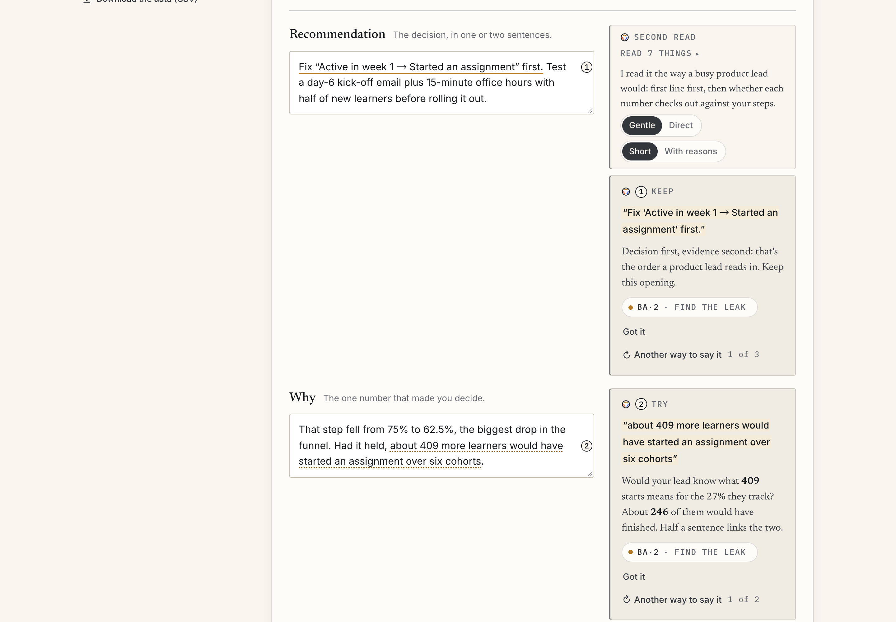
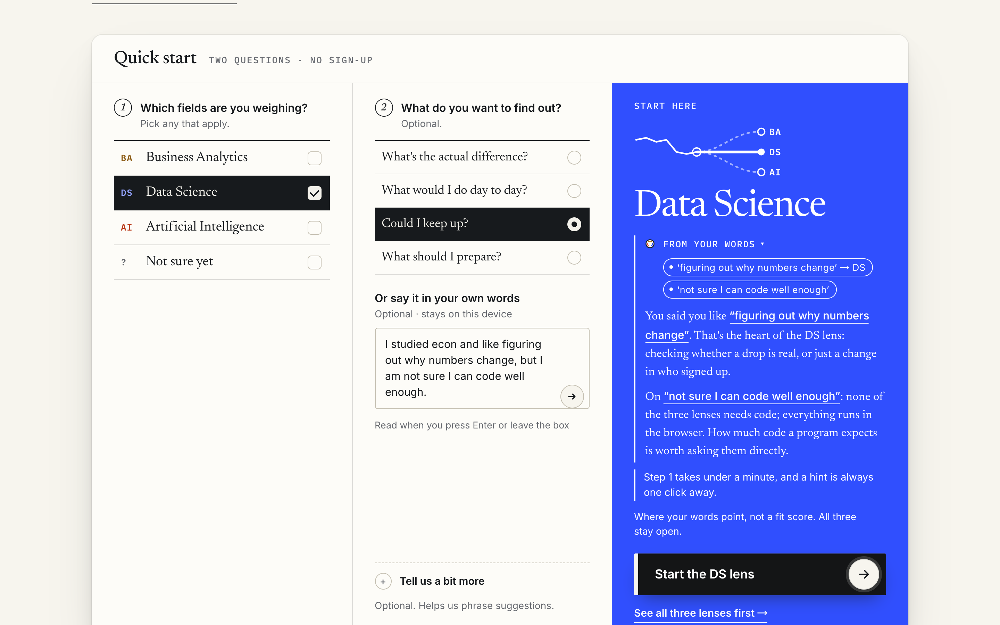
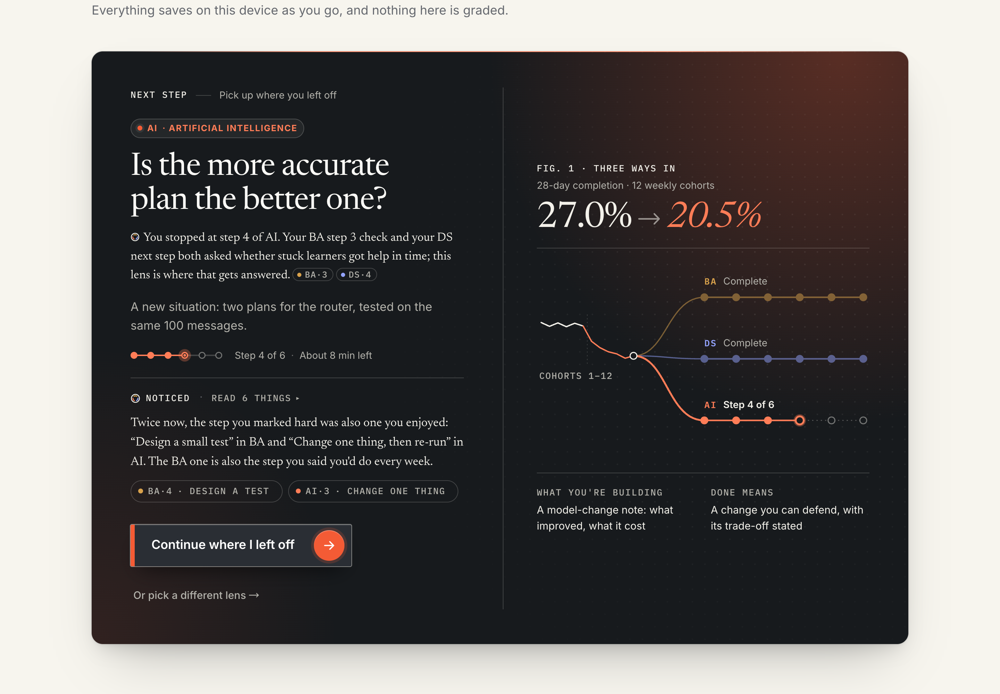
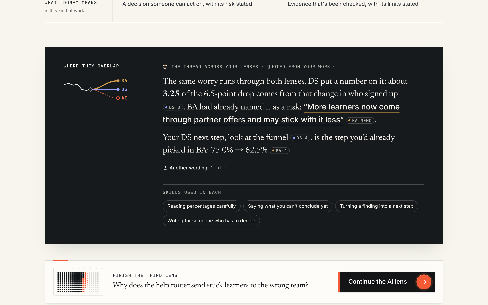
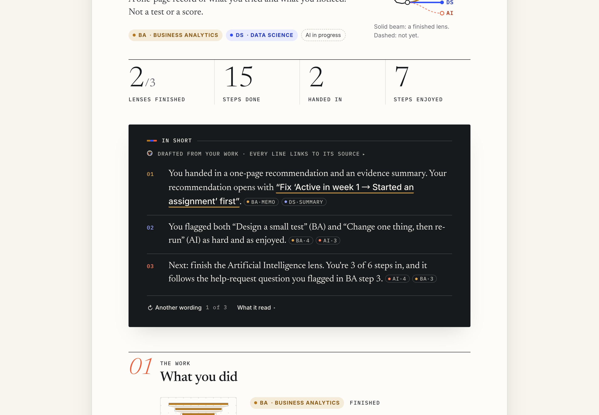
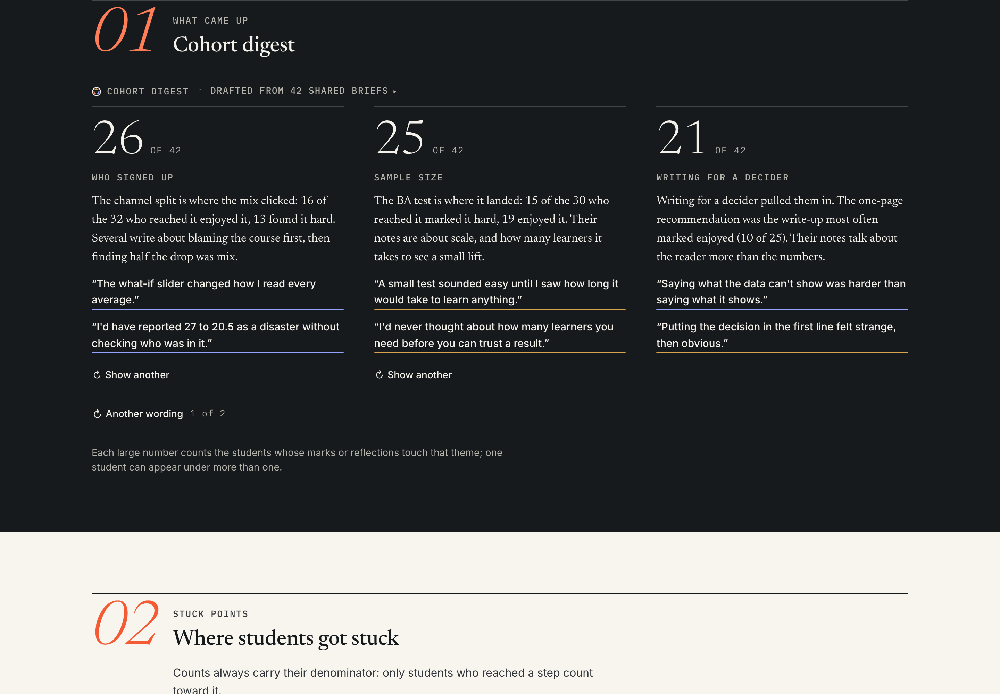
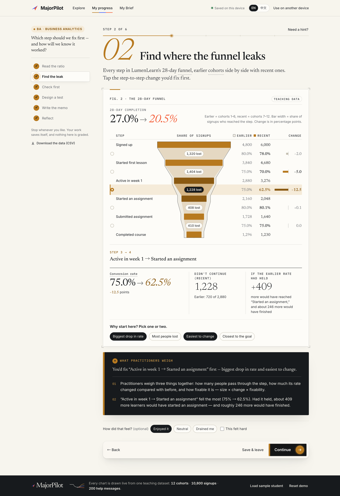

# MajorPilot redesign prototype

A clickable, high-fidelity redesign of the MajorPilot student experience, with a **simulated** AI layer.
It is a standalone static prototype for design review and demos. It does not touch, import or replace the
Vue 3 / Spring Boot product in this repository.


## Run it

No build step and no dependencies. You only need Python 3:

```bash
cd redesign
python3 tools/serve.py 8790
```

Then open <http://localhost:8790>. Plain `python3 -m http.server` also works for browsing. `tools/serve.py`
is threaded and sends no-cache headers, so it handles many parallel screenshot requests.

Useful URL parameters (they are applied once, then removed from the address bar):

| Parameter | Effect |
|---|---|
| `?preset=fresh` | Start as a new student (clears saved progress on this device) |
| `?preset=sample` | Load a sample student who has finished BA and DS and is partway through AI (3 of 6 steps); replaces saved progress on this device |
| `?lang=zh` / `?lang=en` | Switch language (every string exists in English and Simplified Chinese) |
| `?ai=fresh` | Make every AI surface stream again (use this for live demos) |
| `?ai=instant` | Show every AI surface already finished (slow projectors, screenshots); stays on for this tab until `?ai=fresh` or `?ai=live` |
| `?ai=live` | Stream normally, without replaying surfaces already seen |

Progress is saved in `localStorage` (`mp-redesign-v1`) on this device only. "Reset demo" in the footer clears it.

## What changed compared with the current product

- **Value before cost.** A 2-question Quick Start on Home replaces the intake form, and an account is optional.
- **One problem, three lenses.** Business Analytics, Data Science and AI all work on the same fictional
  LumenLearn problem (28-day completion fell from 27.0% to 20.5%). All three run in the browser on one
  shared dataset (`js/data.js`).
- **Feedback inside the step.** "What practitioners weigh" appears right after a choice. Nothing is graded.
- **Leaving is never blocked.** "Save & leave" always works and steps can be skipped.
- **The report becomes a one-page Brief.** It starts with "In short", followed by evidence marks and one
  "What this can't tell you" section. Compare shows only what there is evidence for.
- **"Living data" visual system.** Figures are drawn in code from the shared data, using serif headings, mono
  instrument labels and lens colours (AI vermilion, DS blue, BA ochre).
- **English-first with a full 中文 toggle.** The layout is responsive down to 390 px wide and respects
  reduced-motion settings.

## The AI layer (simulated)

**No model is called.** Every "AI" response is composed in the browser from rules and templates, using only
what the student did: their picks, marks, notes and the shared dataset. It is then rendered with streaming
and reading-trace effects. The footer says so on every page: "AI responses in this prototype are simulated."

Before display, each response is checked: no banned words, every number must come from the data, and every
quote must be an exact substring of the student's text. This mirrors the real product's rule against
showing unchecked or half-streamed model output. The rule throughout: **the AI coaches and quotes; it never
grades, scores, or predicts fit.**

| # | Where | What it does |
|---|---|---|
| AI-1 | BA memo, DS evidence summary, AI model-change note | **Get a second read**: margin notes that quote the student's sentences (Keep first, then Try / A reader might ask / Not sure). Gentle/Direct and Short/With-reasons controls. **Read again** notices revisions. |
| AI-2 | Every lens step except Reflect | **Ask about this step**: suggested questions only (no free-text box), answers cite the real figures and link back to steps |
| AI-3 | Reflect steps | A one-time follow-up question that quotes the student's note, private to My Brief |
| AI-4 | My Brief | "In short" drafts itself with source chips. It can be re-voiced for an advisor or family, and adds questions worth talking through with an advisor. |
| AI-5 | Compare | A thread across lenses that quotes the student's work from two lenses |
| AI-6 | My progress | A "Noticed" observation and a "Why this next" reason (the fixed rule still picks the next step) |
| AI-7 | Home Quick Start | **Or say it in your own words**: phrases are quoted back. Free text never changes the recommendation. |
| AI-8 | `#/school` | A view for advising offices built on a fixed fictional group of 42 students: summary, stuck points, questions for advising sessions. No per-student scores or rankings, and groups smaller than 5 are never summarised. |

Swapping in a real model later means replacing the composers behind `MP.ai` (see `js/ai-kit.js`) while keeping
the checks. The UI contract, including streaming, traces, evidence chips and the fallbacks, stays the same.

| | |
|---|---|
|  |  |
|  |  |
|  |  |

A lens step (Business Analytics, "Find the leak"):



## Routes

`#/home` · `#/explore` · `#/dashboard` (My progress) · `#/brief` (My Brief) · `#/compare` · `#/school` ·
`#/lens/<ba|ds|ai>/<step>` (for example `#/lens/ba/funnel`, `#/lens/ds/split`, `#/lens/ai/change`)

## Layout

```
index.html            entry point (loads everything; no bundler)
css/tokens.css        design tokens and shared components ("Living data")
css/ai-kit.css        AI-layer visuals (.rd-*)
css/*.css             one stylesheet per area (front, dashboard, brief, ba, ds, ai, school)
js/data.js            the shared LumenLearn dataset and lens metadata
js/core.js            global MP: state, router, i18n, helpers, drawing, motion
js/ai-kit.js          MP.ai: streaming, traces, evidence chips, checks, cache, modes
js/pages/*.js         home, explore, dashboard, brief, compare, school
js/lenses/*.js        the three lenses (steps, reveals, hints, summary, second read)
tools/                dev server (serve.py), headless-Chrome screenshots (shot.mjs, shot-motion.mjs,
                      shot1.sh, sweep.sh) and contact-sheet helpers (sheet.sh, tile.sh; need ffmpeg)
CONTRACT.md           build contract: principles, ownership, lens contract, design system (§8), AI layer (§9)
AI-LAYER.md           full AI-layer spec: placements, states, samples, motion, accessibility, not-to-do
docs/DEMO-SCRIPT.md   a 5-minute walkthrough of the AI moments
docs/screenshots/     the images in this README
```

## Screenshot tools (optional)

`tools/shot.mjs` drives headless Chrome over the DevTools protocol. It needs Node 22+ (for the built-in WebSocket), Google
Chrome at the default macOS path, and the dev server running (it loads `http://localhost:8790` unless `MP_BASE`
is set). Captures go to `shots/`, which git ignores:

```bash
node tools/shot.mjs shots/home.png "/?preset=sample#/home" 1440
```

`tools/sweep.sh` captures every route and lens step in fresh and sample states at 1440 px (en and zh) and 390 px, and reports
page errors, failed loads and horizontal overflow.
